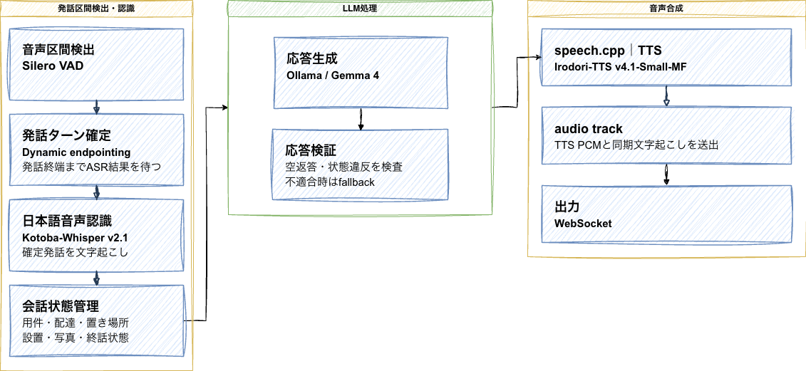

# MONBAN

今あるインターホンに後付けするAI自動対応デバイスです。

https://www.youtube.com/watch?v=Ceq0b2-rC6Y

## 製品概要

MONBANは、今あるインターホンに後付けし、不在時の来客対応を任せられるAIデバイスです。住人に代わってAIが訪問者と会話し、来客をスマホにすぐ通知します。外出先でも、会話の内容や対応結果を確認できます。
他にも、お子様が一人で留守番をしている時や、一人暮らしのお年寄りなどが、悪質な勧誘・営業等にひっかからないよう、防止することも可能です。あなたの家の安心を守る、一番のエージェントです。

# この2日間でつくったもの

設計から始めて、筐体、音声対話システム、スマホアプリをつくり、実際に動く試作機まで仕上げました。既存のインターホンを外側から操作する機構と、来客の話を聞いて返すAIを組み合わせています。

### 筐体：CAD設計から部品調達、組み立てまで

インターホンのボタンを押すための機構と、基板を収める筐体をCADで設計しました。3Dプリンターで出力できるように部品を分け、ボタンの位置に合わせて押し込み部分やサーボの取り付け位置を調整しています。

電子回路も、Infineonの基板の仕様を調べるところから始めました。必要な部品を秋月電子で調達し、配線と組み立てを進め、実際にインターホンを操作するところまで動かしています。この2日間で、CAD上の設計を、手に取って動かせる試作機にしました。

<!-- 写真：CADでの設計、3Dプリントした部品、配線、組み立てた試作機 -->

### ボイスエージェント：聞く、考える、話す仕組みを実装

音声を文字にするSTT、返答を考えるローカルLLM、返答を声にするTTSを組み合わせ、来客と会話するシステムを設計・実装しました。音声認識にはKotoba-Whisper、返答の生成にはOllamaで動かすGemma 4、音声合成にはIrodori-TTSを使っています。各モデルは自分たちのサーバーで動かします。

Silero VADで人が話し始めたことを検出し、ブラウザーでの通話では、AIが話している途中でも割り込めるようにしています。相手の発話を受けて返答するところまで、一連の音声対話として実装しています。

<!-- 画像・動画：音声対話の流れ、実際の会話、割り込みの様子 -->

### スマホアプリ：外出先でも来客をすぐに把握

ExpoとReact Nativeでスマホアプリを開発し、Supabaseにつなぎました。来客をプッシュ通知で知らせ、外出先でも会話の内容や対応結果を確認できます。動作モードやAIへの指示もアプリから設定できます。

家族で使うための招待機能も実装しました。不在時のAI応答と、スマホでの状況確認をつなぐアプリです。

<!-- 画像：来客一覧、会話の詳細、動作モード・AIへの指示の設定 -->

# 競合との違い

MONBANの特長は、既存の室内親機への後付けで、不在時の来客との対話まで任せられることです。

| 競合 | 来客への対応方法 | MONBANとの違い |
|---|---|---|
| SwitchBot（[ボット](https://www.switchbot.jp/products/switchbot-bot)・[ドアホン](https://www.switchbot.jp/products/switchbot-smart-video-doorbell)） | ボットは物理ボタンを押し、ドアホンは[登録音声で自動応答](https://support.switch-bot.com/hc/ja/articles/31601503495319)する。 | MONBANは既存親機を操作し、訪問者の返答に合わせた対話まで自動で行う。 |
| [Alexa+ Greetings](https://www.aboutamazon.com/news/devices/alexa-ring-doorbell-ai-greetings)（比較機種：[Ring Wired Doorbell 4K Pro](https://ring.com/products/wired-doorbell-pro)） | [有線給電の屋外ドアベルを設置](https://ring.com/gb/en/support/articles/2guno/installing-wired-doorbell-4k-pro-hardwired)し、AIが会話する。 | MONBANは屋外機器の交換や既存配線の変更をせず、室内への後付けでAI応答を追加する。 |
| [SwannShield](https://us.swann.com/pages/swannshield) | [対応する専用ドアベル](https://support.swann.com/hc/en-us/articles/41122689903385-SwannShield-Concierge-How-It-Works)でAIが会話する。 | MONBANは室内親機を使うため、集合住宅の共用玄関に別のドアベルを追加しない構成。 |

競合の記載は2026年10月18日時点の公式情報に基づきます。MONBANの対応機種は今後広げていきます。

# 実際の動作

以下は、各場面での応答例です。

### パターン1：配達

[https://www.youtube.com/watch?v=Ceq0b2-rC6Y](https://www.youtube.com/watch?v=Ceq0b2-rC6Y)

配達員には、まず宅配ボックスへの配達を案内します。

> 「宅配ボックスに入れていただけますか。」

宅配ボックスがない場合は、AIでは対面で受け取れないことを伝え、再配達をお願いします。

> 「私はAIのため、対面で荷物を受け取ることができません。再配達をお願いします。」

<!-- 動画：配達 -->

### パターン2：集金

NHKの集金を名乗る訪問者には、AIでは支払いができないことを伝えます。

> 「家主に代わってAIが応対しています。この場ではお支払いできません。」

[▶ 会話を再生（MP4）](docs/audio/shukin.mp4) ／ [音声（MP3）](docs/audio/shukin.mp3)

### パターン3：営業

試供品や無料体験などの営業には、住人の方針に沿って断ります。

> 「申し訳ありませんが、営業のご案内はお断りしています。」

[▶ 会話を再生（MP4）](docs/audio/eigyo.mp4) ／ [音声（MP3）](docs/audio/eigyo.mp3)

### パターン4：予想外の届け物

「干していた服が落ちていたので届けに来ました」という来訪にも、用件を聞いて置き場所を案内します。

> 「届けてくださってありがとうございます。玄関の前に置いていただけますか。」

決まった訪問理由だけでなく、予想外の用件にも相手の話に合わせて返答します。

<!-- 動画：落ちていた服の届け物 -->

### パターン5：回覧板

[▶ 会話を再生（MP4）](docs/audio/kairanban.mp4) ／ [音声（MP3）](docs/audio/kairanban.mp3)

# 技術スタック

<!-- 技術スタック図をここに追加 -->

## ファームウェア：検知・会話通信と、音声再生・物理操作を分担

Infineon PSOC Edge E84とM5Stack Basicを同じWi-Fiに接続し、2台でインターホンへの応答を行います。E84が音を聞いてサーバーと通信し、M5が返答を再生して通話・終了ボタンを操作します。

| 構成 | 使用技術 | 実装している役割 |
|---|---|---|
| PSOC Edge E84（KIT_PSE84_AI） | C、ModusToolbox、FreeRTOS | PDMマイクの連続取得、チャイム検知、会話音声の送受信、通話状態の管理 |
| E84の通信処理 | lwIP、Secure Sockets、TLS、HTTPS / WebSocket（WSS） | APIへの認証付き接続、音声のストリーミング送信、返答音声の中継 |
| M5Stack Basic（ESP32） | C++、Arduino、M5Unified / M5GFX | TCPで受け取った音声の再生、画面への状態表示、2台のサーボ制御 |
| サーボ・設定保存 | LEDC PWM、NVS（Preferences） | 通話・終了ボタンの単発押下、待機位置への復帰、角度・時間設定の永続化 |
| 調整・診断用Web UI | Python、HTML / JavaScript、USBシリアル | 角度・秒数の調整、ボタン単体テスト、通信経路ごとの診断、会話ログ表示 |

### E84のコア構成とチャイム検知

E84のプロジェクトは、起動処理を担うCM33 Secure、通信と通話制御を担うCM33 Non-secure、音声取得と検知を担うCM55に分かれています。CM33 Non-secureとCM55は共有メモリで音声とイベントを受け渡し、ネットワーク処理とマイク取得を分離しています。

内蔵PDMマイクから16 kHz・16 bit・モノラルで音声を取得し、ログメル特徴量を登録済みのチャイム音と照合します。時間の伸び縮みを許容するDTW（動的時間伸縮法）で類似度を判定し、チャイムの検知イベントを通話開始につなげます。

### チャイムから音声会話まで

チャイムを検知すると、E84がM5へ通話開始を要求します。M5は設定された待ち時間の後に通話ボタンを1回押し、待機位置へ戻します。この操作の完了を受けて、E84がバックエンドの音声エージェントを起動します。

会話音声はE84からサーバーの `/api/relay` へWSSで送り、返答のPCM音声をE84経由でM5へTCP転送します。音声形式はPCM16LE・16 kHz・モノラルで、20 ms単位のフレームに分けて処理します。M5は受信音声をバッファに蓄えて順次再生し、ACKで送信量を制御します。ボード間のUDPはチャイム通知と疎通確認に使います。

デバイス側の会話は録音と再生を交互に行います。M5から実際の再生完了通知を受けて次の聞き取りへ進み、発話後の無音を検出してサーバーへ発話の確定を伝えます。会話の終了時には、M5が終了ボタンを1回押して待機位置へ戻ります。

### 取り付けに合わせた調整と動作確認

通話・終了それぞれの待機角度、押下角度、通話前の待ち時間、押下・復帰時間をWeb UIで調整し、M5本体のNVSへ保存できます。サーボは設定した押下位置を指定時間保持し、待機位置へ戻した後にPWM信号を停止します。動作中の重複操作を防ぎ、各ボタンを単独でテストできます。

Web UIでは、両ボードのUSB・Wi-Fi接続、E84とM5間のUDP / TCP、E84とAPI間のHTTPS / WSSを個別に診断できます。会話の認識結果・返答、再生状況、終了理由もログで確認できます。調整・診断にはPCのUSB接続を使い、設定保存後の自動通話はボードとWi-Fi接続で動作します。

実装とセットアップの詳細： [E84ファームウェア](PSOC_Edge_E84/README.md) ／ [M5ファームウェア・調整UI](M5Stack_Basic_E84_Link/README.md) ／ [音声通信プロトコル](PSOC_Edge_E84/docs/voice-stream-protocol.md)

# AIエージェント

来訪者と自然なテンポで会話できるよう、発話検出から音声認識、返答生成、音声合成、再生までの待ち時間を短縮しています。Gemma 4のNo Thinking設定や軽量モデルの採用に加え、モデルの常駐、起動時のウォームアップ、音声のストリーミングを組み合わせています。

## 技術スタック

| 処理 | 技術 | 実装内容 |
|---|---|---|
| 発話区間検出（サーバー側） | Silero VAD | サーバー上で音声区間を検出。最小発話長350 ms、最小無音長500 ms、先行音声400 ms、検出しきい値0.6に設定しています。 |
| 発話ターン確定（サーバー側） | Dynamic endpointing | VADによる発話検出と音声認識結果を使い、返答を開始するタイミングを制御。終端の待機時間は最小550 ms・最大1.5秒に設定しています。 |
| 音声通信 | FastAPI、WebSocket（WSS） | `/api/relay`でPCM16音声と制御情報を送受信。音声は20 ms（640 byte）単位で流し、再生ACKで送信量を制御します。 |
| 音声認識（STT） | Kotoba-Whisper v2.1 | ローカル推論で日本語を文字起こし。インターホンや宅配に特有の語彙をプロンプトに含めます。 |
| 会話制御 | Python、会話状態管理 | 会話コンテキストと住人ルールを扱い、LLMとTTSを連携します。実機音声の搬送はFastAPIのWebSocket中継が担当します。 |
| 返答生成（LLM） | Gemma 4、Ollama | ローカル推論。No Thinking（`reasoning_effort=none`）、`temperature=0.15`、最大96トークンで短い返答を生成します。実行環境に合わせてモデルサイズを抑えています。 |
| 音声合成（TTS） | Irodori-TTS v4.1 Small-MF、speech.cpp | ローカルで音声を合成し、ストリームからPCMフレームを順次送出。長い末尾無音をカットします。 |
| 音声再生 | PSoC Edge E84、M5Stack Basic | 返答音声をインターホンから再生。再生完了のACKを受けて次の聞き取りへ進みます。 |

図はサーバー側でSilero VADとDynamic endpointingを使う音声処理を示しています。E84実機の既定v2経路では、端末側の音量判定で発話を区切り、サーバーで音声認識・返答生成・音声合成を行います。

## パイプライン全体の速度最適化

- **No Thinkingと短い生成長:** Gemma 4の思考出力を無効にし、最大96トークンに制限。回答を短く保ち、生成時間と返答音声の長さを抑えます。
- **モデルの軽量化と常駐:** 実行環境に合うモデルサイズを選び、Ollamaの`keep_alive=30m`で再ロードを避けます。音声合成にもSmall-MFモデルを採用しています。
- **起動時の並列ウォームアップ:** ASR・LLM・TTSをバックグラウンドで並行して準備し、最初の応答にかかるモデル読み込みの待ち時間を減らします。
- **20 ms単位の音声処理:** 音声の判定・転送・再生を短いフレームに分け、長い音声ファイル全体の生成や転送を待たずに処理します。再生ACKに合わせて出力量を調整します。
- **発話終端の待機時間を調整:** サーバーで発話を区切る経路では、Dynamic endpointingの待機時間を550 ms〜1.5秒に設定し、発話の区切りに合わせて返答を開始します。
- **TTSの後処理:** 合成音声の長い末尾無音を除き、返答後の不要な無音を短くします。
