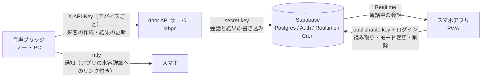

# 会話履歴とスマホアプリ連携 要件（Supabase）

来客ごとの会話と対応結果をサーバー側に保存し、住人のスマホアプリから見られるようにするための要件をまとめる。保存先とアプリの裏側には Supabase を使う。デバイス全体の仕様は [spec.md](spec.md)、作業計画は [plan.md](plan.md) にある。

## 1. 目的と範囲

- 目的: 住人が、留守中や手が離せない間に誰が来て、AI が何を話し、どう対応したかを、後からスマホで確かめられるようにする。
- 範囲: Supabase の構成、door API サーバーに足す機能、音声ブリッジに足す機能、スマホアプリ。
- 対象外: 音声ファイルと映像の保存。音声は保存しない方針（[spec.md 7章](spec.md#7-安全とプライバシー)）を変えず、文字起こしと返答の文字だけを保存する。

## 2. 構成

- Supabase の secret key を持つのは door API サーバーだけにする。ブリッジは今までどおり door API とだけ通信し、扱う鍵を増やさない。
- スマホアプリは publishable key と住人のログインで Supabase に直接つなぐ。RLS（行単位のアクセス制御）で、自分の家の記録だけを読めるようにする。
- 書き込みの経路は door API サーバーに1本化する。会話の内容を知っているのはサーバーで、書き込みの権限もサーバーにだけ持たせるためである。
- 通知は今の ntfy を使い続け、通知からアプリの来客詳細を開けるようにする。

## 3. 機能要件

| ID | 要件 | 優先度 |
|---|---|---|
| HR-1 | チャイムごとに来客の記録（visit）を作る | Must |
| HR-2 | 会話の各発話（訪問者と AI）を時刻順に保存する | Must |
| HR-3 | 対応結果（意図、会社名、対応、要約、終話の理由）を保存する | Must |
| HR-4 | スマホアプリで来客の一覧と詳細（会話の全文）を見る | Must |
| HR-5 | サーバーに届かなかった来客（FALLBACK）も、回線が戻ってから保存する | Should |
| HR-6 | 通話中の会話をスマホアプリでリアルタイムに見る | Should |
| HR-7 | スマホアプリで動作モード（[spec.md 2.3](spec.md#23-動作モード)）を切り替える | Should |
| HR-8 | スマホアプリで来客の記録を削除する（1件ずつ、全件） | Should |
| HR-9 | 保存期間（既定 30 日）を過ぎた記録を自動で消す | Should |
| HR-10 | ntfy の通知からアプリの来客詳細を開く | Should |
| HR-11 | 1つの家を複数の住人（家族）で共有する | Could |
| HR-12 | 呼び出し中に「AI に任せる／自分で出る」をアプリから選ぶ（[spec.md](spec.md) の FR-8 の実装先） | Could |

- HR-7 ができたら、ブリッジの Web 画面によるモード切替（[spec.md 2.3](spec.md#23-動作モード)）はアプリに置き換える。アプリが間に合わなければ Web 画面を残す。

## 4. 非機能要件

| 項目 | 目標 |
|---|---|
| 応答への影響 | Supabase への書き込みが遅れても失敗しても、訪問者との会話は止めない。サーバーは書き込みをためて後で再送する |
| 反映の速さ | 訪問者の発話が確定してから 2 秒以内にアプリに表示する（HR-6） |
| オフライン | Supabase に届かなくても、チャイム検知、押下、会話はこれまでどおり動く |
| 二重登録の防止 | ブリッジが同じ来客を再送しても、記録は1件のままにする |
| リージョン | 東京（ap-northeast-1）に置く |
| 鍵の扱い | secret key は door API サーバーの環境変数だけに置く。アプリには publishable key だけを入れる。どちらもリポジトリに入れない |
| アクセス制御 | 公開スキーマのすべてのテーブルで RLS を有効にする（[6章](#6-権限rls-とグラント)） |
| プライバシー | 訪問者の会社名や名前が文字で残るため、保存期間を設け、住人が削除できるようにする |

## 5. データモデル

`public` スキーマに次のテーブルを置く。時刻はすべて `timestamptz`、選択肢のある列は `text` と check 制約で表す（後から値を足しやすいため）。

### 5.1 テーブル

| テーブル | 主な列 | 説明 |
|---|---|---|
| `households` | `id uuid`（主キー）、`name`、`retention_days int`（既定 30）、`created_at` | 家。記録の持ち主の単位 |
| `household_members` | `household_id`、`user_id`（`auth.users` の ID）、`role`（`owner` / `member`）、`created_at`。主キーは (`household_id`, `user_id`) | 家と住人の対応 |
| `devices` | `id uuid`、`household_id`、`name`、`intercom_model`（例: `VS-MGE20`）、`mode`（`normal` / `omakase` / `away` / `off`）、`allow_okihai_when_away bool`（既定 false）、`last_seen_at`、`created_at` | 本デバイス1台。モードはここに持つ |
| `device_keys` | `device_id`、`key_hash`（一意）、`created_at`、`revoked_at` | door API がブリッジを見分けるための鍵（ハッシュだけを保存）。サーバー専用 |
| `visits` | `id uuid`（ブリッジが生成）、`household_id`、`device_id`、`mode`、`chimed_at`、`answered_at`、`ended_at`、`status`、`intent`、`company`、`outcome`、`end_reason`、`summary`、`created_at`、`updated_at` | 来客1件 |
| `visit_messages` | `id bigint`（identity）、`visit_id`、`household_id`、`seq int`、`speaker`（`visitor` / `assistant` / `device`）、`text`、`spoken_at`、`source`（`door_api` / `fallback_clip`）、`created_at`。(`visit_id`, `seq`) は一意 | 会話の1発話 |
| `visit_decisions`（HR-12） | `visit_id`、`user_id`、`decision`（`ai` / `self`）、`created_at` | 呼び出し中の住人の選択 |

- `visit_messages.household_id` は `visits` と同じ値を重ねて持つ。RLS の判定で毎回 `visits` を結合しないためである。
- `visits.id` をブリッジが生成するのは、オフライン中にためた来客を再送しても二重登録にならないようにするためである（HR-5）。
- 定型音声（[spec.md 5.7](spec.md#57-定型音声)）を流した場合も、`speaker = device`、`source = fallback_clip` で記録する。

### 5.2 列の値

| 列 | 値 |
|---|---|
| `visits.status` | `ringing`（チャイム検知）、`in_call`（通話中）、`completed`（終話）、`fallback`（定型音声で応答）、`missed`（応答しなかった）、`error` |
| `visits.intent` | `delivery`、`sales`、`service`、`acquaintance`、`emergency`、`unknown`（[spec.md 6.4](spec.md#64-通知用の意図判定ブリッジ)） |
| `visits.outcome` | `okihai_requested`（置き配を頼んだ）、`okihai_accepted`（置き配を了承された）、`slip_requested`（不在票を頼んだ）、`declined`（営業などを断った）、`emergency_notified`、`other` |
| `visits.end_reason` | `closing_phrase`（「失礼いたします」）、`silence`（無音）、`time_limit`（上限時間）、`fallback`、`error` |

### 5.3 インデックス

- 外部キーの列（`household_members.user_id`、`devices.household_id`、`visits.device_id`、`visit_messages.visit_id` など）にはすべてインデックスを張る。Postgres は外部キーに自動でインデックスを作らないためである。
- 一覧表示のため `visits (household_id, chimed_at desc)` に、詳細表示のため `visit_messages (visit_id, seq)` にインデックスを張る。
- `visits` を消すと `visit_messages` と `visit_decisions` も消えるよう、外部キーに `on delete cascade` を付ける。

## 6. 権限（RLS とグラント）

### 6.1 Data API への公開

Supabase では、新しく作ったテーブルが Data API に自動では公開されなくなった（2026 年 10 月 30 日から全プロジェクトに適用）。アプリから使うテーブルには、`authenticated` ロールへの権限を明示して与える。`anon` ロールにはどのテーブルも公開しない。

| テーブル | `authenticated` に与える権限 |
|---|---|
| `households`、`household_members`、`visit_messages` | select |
| `devices` | select と、`name`・`mode`・`allow_okihai_when_away` の列だけの update |
| `visits` | select、delete |
| `visit_decisions`（HR-12） | select、insert |
| `device_keys` | なし（サーバー専用） |

アプリから visits と visit_messages に書き込む権限は与えない。書き込みは door API サーバーが secret key で行う。

### 6.2 RLS ポリシー

すべてのテーブルで RLS を有効にし、次のポリシーを置く。ポリシーは `to authenticated` で対象ロールを指定し、所属の条件を必ず組み合わせる（ロールの指定だけでは、ログインした誰もが他の家の記録を読めてしまうため）。

| テーブル | 操作 | 条件 |
|---|---|---|
| `households` | select | 自分がその家の住人である |
| `household_members` | select | 自分の行である、または自分が住人である家の行である |
| `devices` | select、update | 自分が住人である家のデバイスである。update は using と with check の両方に同じ条件を書く（デバイスを他の家へ付け替えられないようにするため） |
| `visits`、`visit_messages` | select | 自分が住人である家の記録である |
| `visits` | delete | 自分がその家の `owner` である |
| `visit_decisions` | select、insert | 自分が住人である家の来客である。insert では `user_id` が自分であることも確かめる |

- 「自分が住人である」の判定は、`private` スキーマ（Data API に公開しない）の関数にまとめる。関数の中で `auth.uid()` を確かめ、`search_path` を空にする。`household_members` のポリシーから同じテーブルを参照すると再帰になるため、この関数を経由する。
- ポリシーの中では `auth.uid()` を `(select auth.uid())` の形で呼ぶ。行ごとに関数を呼ばず、1回の評価で済ませるためである。
- 権限の判定に `user_metadata` を使わない。住人が自分で書き換えられる値だからである。家の役割は `household_members.role` に持つ。
- update には select のポリシーも要る。select がないと、update はエラーを出さずに 0 行を更新して終わる。

### 6.3 Realtime

- 通話中の会話の表示（HR-6）には、`visits` と `visit_messages` の Postgres Changes を使う。Postgres Changes は RLS を守り、読める住人にだけ変更を届ける。
- Supabase のドキュメントは、Postgres Changes を「接続数が少ない用途」に勧めている。1つの家の住人だけが見る本アプリはこれに当たる。利用者が増えたら、データベースのトリガーから送る Broadcast と、`realtime.messages` の RLS で守る非公開チャネルに移る。

## 7. door API サーバーに足す機能

### 7.1 デバイスの認証

- 今の共通の `DOOR_API_KEY` に加え、デバイスごとの API キーを受け付ける。サーバーはキーのハッシュを `device_keys` で引き、どの家のどのデバイスかを知る。
- 開発中は共通キーも使えるようにし、その場合は既定のデバイスとして扱う。

### 7.2 エンドポイント

| メソッドとパス | 呼び出し元 | 内容 |
|---|---|---|
| `POST /v1/visits` | ブリッジ | 来客を作る。本文は `id`（UUID）、`chimed_at`、`mode`。同じ `id` が来たら作り直さず、既存の記録を返す |
| `PATCH /v1/visits/{id}` | ブリッジ | 来客の状態を更新する。`status`、`answered_at`、`ended_at`、`end_reason`、ブリッジのルールで判定した `intent`・`company` |
| `POST /v1/visits/{id}/messages` | ブリッジ | サーバーを通らなかった発話（定型音声など）を足す。オフライン中にためた分の再送にも使う |
| `POST /v1/sessions`（変更） | ブリッジ | 本文に `visit_id` を足す。サーバーはこのセッションの発話をその来客に結び付ける |
| `GET /v1/devices/me` | ブリッジ | 自分のデバイスの `mode` と `allow_okihai_when_away` を返す |

### 7.3 会話の保存

- `user_transcript` を送るたびに、`speaker = visitor` の発話を保存する。
- 1回の返答の生成が終わったら（最後の `ai_text`）、`speaker = assistant` の発話を保存する。
- `seq` はサーバーが来客ごとに 1 から振る。ブリッジが後から足す発話には、サーバーが続きの番号を振る。
- WebSocket が閉じたら、サーバーが LLM で会話から `intent`、`company`、`outcome`、`summary` を作り、`visits` を更新する。これは [spec.md 5.8](spec.md#58-door-api-への追加要望) の「セッション結果の構造化」を兼ねる。サーバーの判定がない項目は、ブリッジのルールの判定で埋める。
- Supabase への書き込みに失敗したら、サーバーはメモリかディスクにためて再送する。会話の処理は待たせない。

## 8. 音声ブリッジに足す機能

- チャイムを検知したら UUID を作り、`POST /v1/visits` で来客を作る。その `visit_id` を `POST /v1/sessions` に渡す。
- 状態が変わるたびに `PATCH /v1/visits/{id}` を送る（押下したら `in_call`、終話したら `completed` など）。
- door API に届かないときは、来客と定型音声の発話をローカルの JSON Lines にため、回線が戻ったら順に送る（HR-5）。
- `GET /v1/devices/me` を 5 秒ごとに呼んでモードを受け取り、手元にも保存する。届かないときは最後に受け取ったモードで動く。
- ntfy の通知に、アプリの来客詳細の URL を付ける（HR-10）。

## 9. スマホアプリ

### 9.1 形態

- ハッカソンでは PWA（Web アプリ）にする。iOS と Android のホーム画面に置け、ストアの審査が要らないためである。
- Supabase のクライアントライブラリ（supabase-js）と publishable key で Supabase につなぐ。パッケージの版は固定し、ロックファイルをコミットする。
- 画面の作り（フレームワーク）は未定（[12章](#12-未確定事項)）。

### 9.2 画面

| 画面 | 内容 | 要件 |
|---|---|---|
| ログイン | メールに届くワンタイムコードかリンクでログインする | HR-4 |
| 来客一覧 | 時刻、意図のアイコン、会社名、対応、状態を新しい順に並べる。通話中の来客には印を付ける | HR-4、HR-6 |
| 来客詳細 | 会話をチャット形式で表示し、要約と終話の理由を添える。通話中は発話が届くたびに追記する | HR-4、HR-6 |
| 設定 | デバイスのモード切替、外出時の置き配の許可、保存期間 | HR-7、HR-9 |
| 削除 | 来客詳細から1件、設定から全件を削除する（`owner` だけ） | HR-8 |
| 家族の招待 | 招待コードで家に住人を足す | HR-11 |

### 9.3 初期設定

ハッカソンでは、家とデバイス、住人の登録をシードの SQL で行う。デバイスの登録手順（ブリッジに表示したコードをアプリで入力する、など）は作らない。

## 10. 保存期間と削除

- Supabase Cron（pg_cron）で毎日1回、`households.retention_days` を過ぎた `visits` を消す。`visit_messages` は外部キーの cascade で一緒に消える。
- 住人がアプリで消した記録も同じく cascade で消える。

## 11. 開発の進め方

- リポジトリに `supabase/` を置き、Supabase CLI でローカルの開発環境を動かす。テーブルとポリシーはマイグレーションのファイルとしてコミットする。
- マイグレーションを確定する前に、Supabase のアドバイザー（`supabase db advisors`）で権限とインデックスの抜けを確かめる。
- アプリ用の型は Supabase CLI で生成する。
- 鍵は `.env` に置き、`.gitignore` に入れる。

### 11.1 試験

| ID | 試験 | 合格基準 |
|---|---|---|
| H1 | RLS: 家 A の住人が家 B の来客を読む、ログインしない利用者が読む | どちらも 0 行 |
| H2 | 権限: 住人がアプリから visits や visit_messages に書き込む、デバイスを他の家へ付け替える | どちらも拒否される |
| H3 | 削除: `member` が来客を消す、`owner` が来客を消す | `member` は消せない。`owner` が消すと会話も一緒に消える |
| H4 | リアルタイム: 通話中の発話がアプリに出るまでの時間 | 2 秒以内 |
| H5 | 再送: 同じ来客を3回送る | 記録は1件 |
| H6 | 障害: Supabase に届かない状態で来客を受ける | 会話は止まらず、回線が戻った後に記録がそろう |
| H7 | 保存期間: `retention_days` を過ぎた記録を用意し、Cron を動かす | 該当する記録と会話が消える |

## 12. 未確定事項

| 項目 | 影響 | 確認方法 |
|---|---|---|
| door API に 7章の機能を足せるか | 書き込みの経路。足せなければ、ブリッジが Edge Functions 経由で書き込む案に変える | サーバーの担当者に相談する |
| スマホアプリの画面の作り（フレームワーク） | アプリの実装 | 担当者が決める |
| Supabase のプランとプロジェクトの作成者 | 使える機能と上限 | チームで決める |
| ログインの方式 | メールの文面を変えるには、無料プランでは独自の SMTP が要る（2026 年 6 月の変更） | ハッカソンでは既定の文面で済ませる |
| 保存期間の既定値（30 日） | プライバシーと使い勝手 | チームで決める |
| 家族での共有（HR-11）を作るか | テーブルと画面の範囲 | 作業時間を見て決める |

## 13. 参考資料

- Supabase の変更履歴: https://supabase.com/changelog
- 新しいテーブルが Data API に自動で公開されなくなる変更: https://supabase.com/changelog/45329-breaking-change-tables-not-exposed-to-data-and-graphql-api-automatically
- 無料プランのメール文面の変更: https://supabase.com/changelog/46599-changes-to-email-template-customisation-on-free-tier
- publishable key と secret key: https://supabase.com/docs/guides/getting-started/migrating-to-new-api-keys
- Data API の保護: https://supabase.com/docs/guides/api/securing-your-api
- RLS: https://supabase.com/docs/guides/database/postgres/row-level-security
- Realtime の始め方（Postgres Changes を使う場面）: https://supabase.com/docs/guides/realtime/getting_started
- Realtime の権限: https://supabase.com/docs/guides/realtime/authorization
- Broadcast: https://supabase.com/docs/guides/realtime/broadcast
- Supabase Cron: https://supabase.com/docs/guides/cron
- ntfy の送信（Click でリンクを付ける）: https://docs.ntfy.sh/publish/
