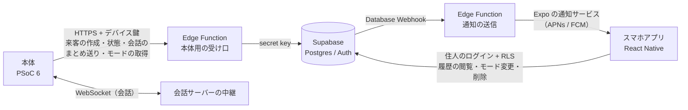

# 会話履歴とスマホアプリ連携 要件（Supabase）

来客ごとの会話と対応結果を Supabase に保存し、住人のスマホアプリから見られるようにするための要件をまとめる。デバイス全体の仕様は [spec.md](spec.md)、作業計画は [plan.md](plan.md) にある。

この文書では、チームが決めたこと（[1章](#1-決定事項)）と、決定を受けて書いた提案（2〜8章）、まだ決めていないこと（[9章](#9-決めていないこと)）を分けて書く。2〜8章の提案は、2026 年 10 月 17 日にチームが実装の前提として承認した。その後、PC を使わない決定に合わせて、本体を PSoC 6、認証を Edge Function とデバイス鍵に改めた。

## 1. 決定事項

2026 年 10 月 17 日にチームで決めた。

| 項目 | 決定 |
|---|---|
| 書き込み口 | 本体（PSoC 6）が書き込む。会話サーバーは書き込みに関わらない |
| 本体の認証 | PSoC 6 は Supabase に直接ログインせず、Edge Function に固定のデバイス鍵を付けて HTTPS で送る |
| 会話の文字を書く時期 | PSoC 6 が終話後にまとめて送る |
| 保存する内容 | 訪問者の発話の文字起こし、AI の返答の文字、対応結果。音声と画像は保存しない |
| 要約 | 作らない（要件から外す） |
| 保存期間 | 無期限（自動では消さない） |
| アプリでできること | 履歴の閲覧、即時通知、動作モードの切り替え |
| アプリの形態 | React Native で作るネイティブアプリ |
| iPhone での通知 | 受ける。Apple Developer Program には登録済み |
| 通知の送り方 | Expo の通知サービス |
| 記録の削除 | 住人がアプリから1件ずつ消せる。会話も一緒に消える |
| 裏側 | Supabase。ローカルで試験したうえで、クラウドのプロジェクトにも適用する |
| 2〜8章の提案 | 実装の前提として承認 |

本体を書き込み口にしたのは、本体がチャイムの時刻、押下、モード、定型音声で応答した来客など、来客のすべてを知っているためである。サーバーに届かなかった来客も記録でき、本体の機能を足すときにサーバーを改修せずに済む。会話の文字は、PSoC 6 が会話サーバーの中継（[spec.md 5.4](spec.md#54-会話サーバーの中継)）から受け取る文字起こしを使う。

PC は使わない（[spec.md](spec.md) v0.7）。以前の版にあったノート PC の音声ブリッジは、本体から外した。

## 2. 構成（提案）

- 本体は Edge Function（本体用の受け口）に、固定のデバイス鍵を付けて送る。Edge Function は鍵のハッシュを照合して、どの家のどのデバイスかを知り、secret key で書き込む。secret key は本体に置かない。
- 通知は、来客の記録が書き込まれたことを Database Webhook で Edge Function に知らせ、Edge Function がプッシュ通知を送る。通知を送るための鍵は Edge Function の側にだけ置く。Supabase のドキュメントにもこの形の例がある。
- アプリは、住人のログインと RLS で、自分の家の記録だけを読める。

## 3. 機能要件

優先度は提案である。

| ID | 要件 | 優先度（提案） |
|---|---|---|
| HR-1 | チャイムごとに来客の記録を作る | Must |
| HR-2 | 会話の各発話（訪問者、AI、定型音声）を順番どおりに保存する | Must |
| HR-3 | 対応結果（意図、会社名、対応、終話の理由）を保存する | Must |
| HR-4 | アプリで来客の一覧と詳細（会話の全文、対応結果）を見る | Must |
| HR-5 | 来客時と対応後に、アプリへプッシュ通知を送る | Must |
| HR-6 | アプリで動作モード（[spec.md 2.3](spec.md#23-動作モード)）を切り替え、本体に反映する | Must |
| HR-7 | Supabase に届かなかった来客を、本体が回線の回復後に送る | Should |
| HR-8 | 住人がアプリから来客の記録を1件ずつ消す。会話も一緒に消える | Should |

## 4. 本体が書き込むもの（提案）

| 本体の出来事 | 書き込み |
|---|---|
| チャイムを検知した | 来客を作る（状態は「呼び出し中」） |
| 【通話】の押下が終わった | 来客を「通話中」にし、応答時刻を入れる |
| 終話した | 来客を「終話」にし、終話時刻と終話の理由を入れる |
| 終話した後 | 会話の全発話（訪問者、AI、定型音声）と対応結果（意図、会社名、対応）をまとめて送る |

- 来客の ID と発話の順番は本体が付ける。同じ来客や発話を送り直しても、記録が増えないようにするためである。
- Supabase に届かないときは、本体のフラッシュにためて、回線が戻ったら順に送る（HR-7）。
- 対応結果の判定を PSoC 6 と Edge Function のどちらで行うかは決めていない（[spec.md 6.3](spec.md#63-対応結果の判定)）。

## 5. アプリ（提案）

| 画面 | 内容 | 要件 |
|---|---|---|
| ログイン | 住人がログインする | HR-4 |
| 来客一覧 | 時刻、意図、会社名、対応を新しい順に並べる | HR-4 |
| 来客詳細 | 会話をチャット形式で表示し、対応結果と終話の理由を添える | HR-4 |
| 設定 | デバイスの動作モードを切り替える | HR-6 |
| 削除 | 来客詳細から、その来客の記録を消す | HR-8 |

- プッシュ通知は Expo の通知サービスで送る（1章で決定）。Supabase のドキュメントに React Native と Expo の例があり、iPhone 向けの APNs の資格情報は Expo のビルド（EAS）で用意できる。
- iPhone への配信には APNs を使う。チームは Apple Developer Program に登録済みなので、そのまま使える。
- 通知を受けるための端末ごとのトークンは、Supabase のテーブルに保存する。

## 6. データモデル（提案）

| テーブル | 主な列 | 説明 |
|---|---|---|
| `households` | `id`、`name`、`created_at` | 家。記録の持ち主の単位 |
| `household_members` | `household_id`、`user_id`、`role`、`created_at` | 家と住人の対応 |
| `devices` | `id`、`household_id`、`name`、`mode`、`last_seen_at`、`created_at` | 本体1台。モードはここに持つ |
| `device_keys` | `device_id`、`key_hash`（一意）、`created_at`、`revoked_at` | 本体のデバイス鍵（ハッシュだけを保存）。Edge Function だけが使う |
| `visits` | `id`（本体が生成）、`household_id`、`device_id`、`mode`、`chimed_at`、`answered_at`、`ended_at`、`status`、`intent`、`company`、`outcome`、`end_reason`、`created_at`、`updated_at` | 来客1件 |
| `visit_messages` | `visit_id`、`household_id`、`seq`、`speaker`（訪問者・AI・定型音声）、`text`、`spoken_at`、`created_at`。(`visit_id`, `seq`) は一意 | 会話の1発話 |
| `push_tokens` | `user_id`、`token`、`platform`、`created_at`、`last_seen_at` | 通知の送り先 |

- `status`、`intent`、`outcome`、`end_reason` の値は、[spec.md 5.1](spec.md#51-状態遷移psoc-6) の状態と [spec.md 6.3](spec.md#63-対応結果の判定) の意図に合わせる。
- 外部キーの列と、一覧の並び（家ごとの新しい順）にはインデックスを張る。
- 記録は自動では消さない（保存期間は無期限）。来客を消す場合は、その発話も一緒に消えるようにする。

## 7. 権限（提案）

### 7.1 だれが何をできるか

| テーブル | 住人 | 本体（Edge Function 経由） |
|---|---|---|
| `households`、`household_members` | 自分の家の行を読む | なし |
| `devices` | 自分の家のデバイスを読み、モードを変える | 自分の行のモードを読む |
| `visits` | 自分の家の来客を読む、消す | 自分のデバイスの来客を作る、読む、更新する |
| `visit_messages` | 自分の家の発話を読む | 自分のデバイスの来客に発話を足す |
| `push_tokens` | 自分のトークンを登録、更新、削除する | なし |
| `device_keys` | なし | なし（Edge Function だけが読む） |

本体の操作は Edge Function が secret key で行う。Edge Function は、鍵で特定したデバイスの来客にだけ書き込むよう、自分の処理の中で確かめる（secret key は RLS を通らないため）。

### 7.2 Supabase で守ること

- Supabase では、新しいテーブルが Data API に自動では公開されなくなった（2026 年 10 月 30 日から全プロジェクトに適用）。上の表の操作に要る権限だけを明示して与える。
- 公開スキーマのすべてのテーブルで RLS を有効にする。ポリシーは対象ロールの指定と、家やデバイスの所属の条件を必ず組み合わせる。ロールの指定だけでは、ログインした誰もが他の家の記録を読めてしまう。
- 住人の見分けは `household_members` で行う。利用者が自分で書き換えられる `user_metadata` は権限の判定に使わない。
- 住人が来客を消すには、読み取りのポリシーも要る。
- モードの変更は、本体が Edge Function から一定間隔で読んで反映する。マイコンでは Realtime を使わない。

## 8. 試験（提案）

| ID | 試験 | 合格基準 |
|---|---|---|
| H1 | 住人が他の家の来客を読む。ログインしていない利用者が読む | どちらも 0 行 |
| H2 | 本体が他のデバイスの来客を書く。誤った鍵や取り消した鍵で送る | 拒否される |
| H3 | 住人がアプリから来客や発話を書き込む。住人が他の家の来客を消す | 拒否される |
| H3b | 住人が自分の家の来客を消す | 来客とその発話が消える |
| H4 | 本体が同じ来客と発話を3回送る | 記録は1件ずつ |
| H5 | Supabase に届かない状態で来客を受ける | 会話は止まらず、回線の回復後に記録がそろう |
| H6 | チャイムからアプリに通知が届くまでの時間 | 目標値は未定（[9章](#9-決めていないこと)） |
| H7 | アプリでモードを変えてから本体に反映されるまでの時間 | 目標値は未定 |

## 9. 決めていないこと

| 項目 | 選択肢や論点 |
|---|---|
| 家族で共有するか | 1つの家に複数の住人を登録するか |
| 通知の内容と時期 | 来客時と対応後の2回か、対応後だけか |
| 通知とモード反映の目標時間 | H6、H7 の合格基準 |
| ログインの方式 | メール、Google など。無料プランでメールの文面を変えるには独自の SMTP が要る |
| クラウドのプロジェクトの作成先 | 組織、プラン、リージョン |

## 10. 参考資料

- Supabase のプッシュ通知の例（Database Webhook と Edge Function、Expo と FCM）: https://supabase.com/docs/guides/functions/examples/push-notifications
- Database Webhooks: https://supabase.com/docs/guides/database/webhooks
- 新しいテーブルが Data API に自動で公開されなくなる変更: https://supabase.com/changelog/45329-breaking-change-tables-not-exposed-to-data-and-graphql-api-automatically
- 無料プランのメール文面の変更: https://supabase.com/changelog/46599-changes-to-email-template-customisation-on-free-tier
- publishable key と secret key: https://supabase.com/docs/guides/getting-started/migrating-to-new-api-keys
- Data API の保護: https://supabase.com/docs/guides/api/securing-your-api
- RLS: https://supabase.com/docs/guides/database/postgres/row-level-security
