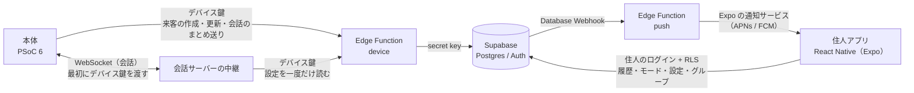

# 会話履歴とスマホアプリ連携 要件（Supabase）

来客ごとの会話と対応結果を Supabase に保存し、住人のスマホアプリから見られるようにするための要件と、現在の実装をまとめる。デバイス全体の仕様は [spec.md](spec.md)、作業計画は [plan.md](plan.md) にある。

実装の細部は、それぞれの README を正とする。

- Supabase: `supabase/README.md`（PR #4、ブランチ `claude/adoring-wu-cc9eae`）
- アプリ: `mobile/README.md`（ブランチ `claude/mobile-app`、未 push）

## 1. 決定事項

2026 年 10 月 17 日にチームで決めた。

| 項目 | 決定 |
|---|---|
| 書き込み口 | 本体（PSoC 6）が書き込む。会話サーバーは書き込みに関わらない |
| 本体の認証 | PSoC 6 は Supabase に直接ログインせず、Edge Function「device」に固定のデバイス鍵を付けて HTTPS で送る |
| 会話の文字を書く時期 | PSoC 6 が終話後にまとめて送る |
| 保存する内容 | 訪問者の発話の文字起こし、AI の返答の文字、対応結果。音声と画像は保存しない |
| 要約 | 作らない |
| 保存期間 | 無期限（自動では消さない） |
| 記録の削除 | 住人がアプリから1件ずつ消せる。会話も一緒に消える |
| アプリでできること | 履歴の閲覧、即時通知、動作モードの切り替え |
| アプリの形態 | React Native（Expo）のネイティブアプリ。iPhone でも通知を受ける（Apple Developer Program に登録済み） |
| 通知の送り方 | Expo の通知サービス |
| 家ごとの設定 | 「AI への追加の指示」と「外出時の置き配の許可」を、会話の開始時に会話サーバーの中継が一度だけ読み、会話エージェントに渡す。読むのは中継で、PSoC 6 ではない |
| 裏側 | Supabase。ローカルで試験したうえで、クラウドのプロジェクトにも適用する |

PC は使わない（[spec.md](spec.md) v0.7）。本体を書き込み口にしたのは、本体がチャイムの時刻、押下、モード、定型音声で応答した来客など、来客のすべてを知っているためである。

## 2. 構成

- 本体と中継は Edge Function「device」をデバイス鍵で呼ぶ。Edge Function は鍵を確かめてから secret key で読み書きする。本体にも中継にも secret key は置かない。
- 通知は、来客の作成と終話への更新を Database Webhook で Edge Function「push」に渡し、Expo の通知サービスで送る。
- アプリは住人のログインと RLS で、自分のグループの記録だけを読む。

## 3. 機能要件

| ID | 要件 | 優先度 | 状態 |
|---|---|---|---|
| HR-1 | チャイムごとに来客の記録を作る | Must | 実装済み（本体側は未実装） |
| HR-2 | 会話の各発話（訪問者、AI、定型音声）を順番どおりに保存する | Must | 実装済み（本体側は未実装） |
| HR-3 | 対応結果（意図、会社名、対応、終話の理由）を保存する | Must | 実装済み（本体側は未実装） |
| HR-4 | アプリで来客の一覧と詳細（会話の全文、対応結果）を見る | Must | 実装済み（Supabase につないだ確認は未実施） |
| HR-5 | 来客時と対応後に、アプリへプッシュ通知を送る | Must | 実装済み（クラウドの `EXPO_ACCESS_TOKEN` は未設定） |
| HR-6 | アプリで動作モードを切り替え、本体に反映する | Must | 実装済み（本体側は未実装） |
| HR-7 | Supabase に届かなかった来客を、本体が回線の回復後に送る | Should | 本体側は未実装 |
| HR-8 | 住人がアプリから来客の記録を1件ずつ消す。会話も一緒に消える | Should | 実装済み |
| HR-9 | 住人がアプリで「AI への追加の指示」と「外出時の置き配の許可」を設定し、会話に反映する | Must | Supabase とアプリは実装済み。中継は開発中 |
| HR-10 | グループ（家）を作り、家族を招待で参加させる | － | Supabase とアプリで実装済み |
| HR-11 | 本体をペアリングコードでグループに結び付ける | － | Supabase とアプリで実装済み |

HR-10 と HR-11 は、Supabase とアプリの実装の中で加わったため、優先度を付けていない。

## 4. 本体と中継が使う API

Edge Function「device」に、`Authorization: Bearer <デバイス鍵>` を付けて呼ぶ。鍵がないか知らない鍵なら 401 を返す。

| 要求 | 呼ぶ側 | 内容 |
|---|---|---|
| `GET /functions/v1/device/settings`（`/mode` も同じ） | 本体、中継 | `paired`、`mode`、`away_leave_at_door`、`auto_away`、`extra_instructions` を返す |
| `PUT /functions/v1/device/visits/<来客 id>` | 本体 | 来客の作成と更新。会話の発話（`messages`）も同じ要求でまとめて送れる |
| `PUT /functions/v1/device/state` | 本体 | `auto_away_active`（本体が自動で外出にしたか）を書く |

- 来客 id は本体が作る uuid。同じ id で何度送っても、同時に送っても、来客は1件になる。同じ `seq` の発話は足さない。
- 状態は「呼び出し中」→「通話中」→「終話」または「応答しなかった」の順にしか進まない。遅れて届いた古い送信は、来客の行を変えず発話だけを足す。
- グループに結び付く前の本体（`paired` が false）の書き込みは 409 になる。
- 中継は会話の始めに設定を一度だけ読み、`extra_instructions` と `away_leave_at_door` を会話エージェントの `house_rules` に入れる。`extra_instructions` には字数の上限がまだないため、`house_rules` 全体が 800 字を超えないよう中継が切る。

## 5. アプリ

React Native（Expo SDK 58）で `mobile/` に実装した。画面は Claude Design のデザイン（https://claude.ai/artifact/G9j5naxUGESrVJmT1pxSab ）に合わせている。

| 画面 | 内容 |
|---|---|
| ログイン、アカウント作成 | メール、Apple、Google でログインする |
| グループの作成、招待で参加 | グループを作る。招待のリンクや QR コードで参加する |
| 来客一覧、来客詳細 | 来客を新しい順に並べ、詳細で会話をチャット形式で表示する。右上の「…」から削除する |
| 設定 | 動作モード、外出時の置き配、だれもいないとき外出にする |
| AI への追加の指示 | 住人が自由文で書く |
| グループ、家族を招待 | メンバーの一覧、招待のリンクと QR コード |

- シミュレータで確かめたのは、ログインとアカウント作成の画面だけである。他の画面は Supabase につないでから確かめる。
- プッシュ通知の端末ごとのトークンは `push_tokens` に保存する。

## 6. データモデル

| テーブル | 主な列 | 説明 |
|---|---|---|
| `households` | `id`、`name` | グループ（家） |
| `household_members` | `household_id`、`user_id`（一意）、`role`（`owner`・`member`、権限は同じ） | 住人。1人が入れるグループは1つ |
| `household_invites` | グループごとの招待トークン | 有効期限なし、何度でも使える |
| `devices` | `id`、`household_id`、`name`、`mode`、`away_leave_at_door`、`auto_away`、`auto_away_active`、`extra_instructions`、`last_seen_at` | 本体1台。モードと設定をここに持ち、グループで共有する |
| `device_keys` | `key_hash`（SHA-256）、`device_id` | デバイス鍵。どのロールにも権限を与えない |
| `device_pairing_codes` | ペアリングコード | 本体をグループに結び付ける |
| `visits` | `id`（本体が生成）、`household_id`、`device_id`、`mode`、`chimed_at`、`answered_at`、`ended_at`、`status`、`intent`、`company`、`outcome`、`end_reason` | 来客1件 |
| `visit_messages` | `visit_id`、`household_id`、`seq`、`speaker`、`text`、`spoken_at` | 会話の1発話。(`visit_id`, `seq`) は一意 |
| `push_tokens` | `user_id`、`token`、`platform` | 通知の送り先 |
| `push_deliveries` | 端末ごとの通知の送信待ち | Expo の一時的な失敗を pg_cron で送り直す |

主な列の値は次のとおり。[spec.md](spec.md) の状態遷移と対応結果も、この値に合わせる。

| 列 | 値 |
|---|---|
| `mode` | `normal`（通常）、`omakase`（おまかせ）、`away`（外出）、`off`（停止） |
| `visits.status` | `ringing`（呼び出し中）、`in_call`（通話中）、`ended`（終話）、`missed`（応答しなかった） |
| `visits.intent` | `delivery`、`sales`、`service`、`emergency`、`acquaintance`（知人）、`unknown` |
| `visits.outcome` | `leave_at_door`（置き配）、`delivery_slip`（不在票）、`declined`（断った）、`callback`（改めて連絡するよう依頼）、`escalated`（家の者に連絡すると伝えた）、`none` |
| `visits.end_reason` | 終話: `closing`、`silence`、`time_limit`、`fallback`、`safe`。応答しなかった来客: `mode_off`、`resident`、`no_answer` |
| `visit_messages.speaker` | `visitor`（訪問者）、`ai`（AI）、`canned`（定型音声） |

## 7. 権限

| 対象 | 住人（アプリ） | 本体・中継（Edge Function 経由） |
|---|---|---|
| グループ、メンバー | 自分のグループを読む。グループの作成、招待、参加は関数で行う | なし |
| `devices` | 自分のグループの本体を読み、`mode`、`away_leave_at_door`、`auto_away`、`extra_instructions` を変える | 自分の設定を読む。`auto_away_active` を書く |
| `visits` | 自分のグループの来客を読み、1件ずつ消す（2件以上を一度に消すとトリガーが拒否する） | 自分の本体の来客を作り、更新する |
| `visit_messages` | 自分のグループの発話を読む | 自分の本体の来客に発話を足す |
| `push_tokens` | 自分のトークンを登録、更新、削除する | なし |

- 公開スキーマのすべてのテーブルで RLS を有効にし、Data API には必要な操作だけを明示して与えている（2026 年 10 月 30 日から、新しいテーブルは Data API に自動では公開されない）。
- 権限の判定に、利用者が書き換えられる `user_metadata` は使わない。メンバーの名前の表示にだけ使う。

## 8. 通知

- 来客時（来客の作成）と対応後（終話への更新）の2回送る。応答しなかった来客には対応後の通知を送らない。優先度は high にする。
- 対応後の通知には、意図、会社名、対応と、訪問者の最初の発話の先頭 40 字を載せる。
- 回線断から回復して、終話済みの来客が初めて届いたときは、対応後の通知だけを送る。
- Expo の一時的な失敗は3回まで試し、届かなければ pg_cron が1分ごとに送り直す。作ってから 10 分たった通知は送り直さない。

## 9. 試験

| 試験 | 件数 | 主な内容 |
|---|---|---|
| pgTAP | 126 | 他のグループの記録を読めない、他の本体の来客に書けない、住人は来客や発話を書けない、1件ずつの削除、再送で記録が増えない、デバイス鍵の保護、グループと招待、ペアリング、通知の送り直し |
| 結合試験（ローカル） | 65 | Auth、Data API、2つの Edge Function、Webhook、Expo、pg_cron の送り直し |
| Edge Function | 14 | 通知を送る条件と文面、優先度、試し直し |

- 回線断からの回復（HR-7）の試験は、本体の実装と一緒に行う。
- 通知が届くまでの時間と、モードの反映にかかる時間の目標は決めていない。

## 10. 決めていないこと

| 項目 | 論点 |
|---|---|
| 「だれもいないとき外出にする」（`auto_away`）と、応答しなかった理由の「住人が近づいた」（`resident`） | どちらも人の有無を知る手段が要るが、基板にレーダーはない（[spec.md 10章](spec.md#10-未確定事項)）。扱いを決める |
| AI への追加の指示の上限字数 | 今は上限がなく、中継が切る |
| アプリ名とバンドル ID | 今は仮の `com.jphacks.tka2601` |
| 本体をグループに結び付ける手順 | 管理者が本体を登録してペアリングコードを渡す今の手順で足りるか |
| クラウドの準備 | `EXPO_ACCESS_TOKEN` とシード（グループ、住人、本体、デバイス鍵）が未設定 |
| ログイン方式の設定 | Apple、Google の設定と、メール確認に独自の SMTP を使うか |
| 通知とモード反映の目標時間 | 合格基準 |

## 11. 参考資料

- Supabase のプッシュ通知の例（Database Webhook と Edge Function、Expo と FCM）: https://supabase.com/docs/guides/functions/examples/push-notifications
- Database Webhooks: https://supabase.com/docs/guides/database/webhooks
- 新しいテーブルが Data API に自動で公開されなくなる変更: https://supabase.com/changelog/45329-breaking-change-tables-not-exposed-to-data-and-graphql-api-automatically
- 無料プランのメール文面の変更: https://supabase.com/changelog/46599-changes-to-email-template-customisation-on-free-tier
- publishable key と secret key: https://supabase.com/docs/guides/getting-started/migrating-to-new-api-keys
- RLS: https://supabase.com/docs/guides/database/postgres/row-level-security
