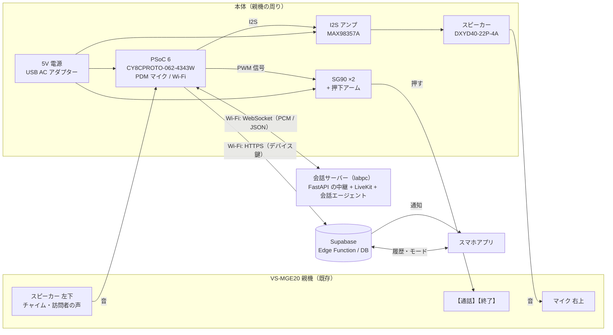
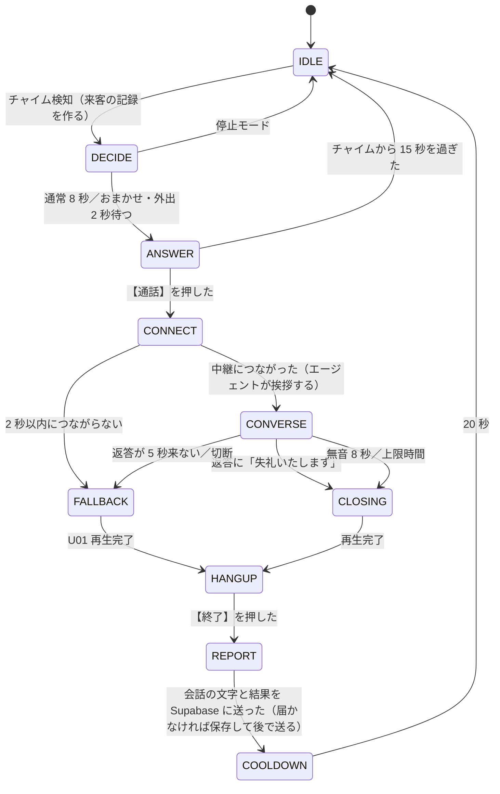

# インターホン自動応答 AI デバイス 仕様書 v0.8

Hack Day で作るデバイスの要件、ハードウェア構成、ソフトウェア、AI の設計をまとめる。作業計画は [plan.md](plan.md)、会話履歴とスマホアプリの要件は [history.md](history.md) に分けた。未確定の事項は [10章](#10-未確定事項)、調べた資料は [11章](#11-参考資料) に集めている。

改訂の経緯は次のとおり。

- v0.3: 会話 AI を自前の会話サーバーに任せる構成へ改めた。
- v0.4: 手持ちの部品で作る構成に改めた。
- v0.5: 対象のインターホンを Panasonic VS-SGE20LA（親機 VS-MGE20）に決めた。
- v0.6: 会話履歴を Supabase に保存し、スマホアプリから見る要件を加えた（[history.md](history.md)）。
- v0.7: PC を使わない構成に改めた。ノート PC の音声ブリッジと、それを前提にした仕様（USB シリアル、PC のスピーカーとマイク、ブリッジの Web 画面、ntfy）を消した。PSoC 6 が Wi-Fi で会話サーバーと Supabase に直接つなぎ、SG90 を直接動かし、I2S アンプでスピーカーを鳴らす。会話サーバーは main の LiveKit 版を使い、PSoC 用の WebSocket の中継を足す。基板は CY8CPROTO-062-4343W に確定し、チャイム検知は実装済みの登録式（DTW）にした。
- v0.8: Supabase（PR #4）とアプリ（`mobile/`）の実装、中継が家の設定を読む流れに合わせて直した。本体の API、対応結果の値、`house_rules` の組み立てを実装に合わせた。

## 1. 概要

室内のハンズフリー型インターホン親機の横に後付けし、住人が玄関に出られないときに代わりに来客へ応答するデバイスである。本体は PSoC 6 の基板1枚で、PC は使わない。チャイム検知とボタン押下は本体の中で完結させ、訪問者との会話は自前の会話サーバー（labpc）で行う。会話サーバーは外部のクラウド AI API を使わず、オープンなモデルを動かしている。会話サーバーに届かないときは、本体に保存した定型音声だけで応答する。

### 1.1 基本シナリオ（在宅だが手が離せないときの宅配）

1. 訪問者が玄関子機を押し、親機がチャイムを鳴らす。
2. PSoC 6 がマイクでチャイムを検知し、Supabase に来客の記録を作る。
3. PSoC 6 が動作モード（[2.3](#23-動作モード)）を確かめ、SG90 で親機の【通話】を押す。
4. PSoC 6 が会話サーバーに WebSocket でつなぐ。会話エージェントが「はい、どちら様でしょうか」と話し、PSoC 6 がスピーカーで鳴らす。
5. 訪問者が「ヤマト運輸です、お荷物のお届けです」と答える。PSoC 6 はマイクの音を会話サーバーへ送る。
6. 会話サーバーが文字起こし、返答の生成、音声合成を行い、返答「恐れ入りますが、玄関の前に置いていただけますか」を PSoC 6 が鳴らす。
7. 訪問者がサインや代引きを理由に断った場合は、エージェントが不在票を頼む。
8. エージェントが「失礼いたします」で締めたら、PSoC 6 がもう1つの SG90 で【終了】を押す。
9. PSoC 6 が会話の文字と対応結果をまとめて Supabase に送り、住人のスマホアプリに通知が届く。

### 1.2 不在時のシナリオ

手順 1〜6 は同じである。手順 6 でエージェントは置き配ではなく不在票を頼む。不在時に置き配を頼まない理由は [3.5](#35-置き配を頼むのは在宅時に限る) に書いた。

## 2. 要件

### 2.1 機能要件

| ID | 要件 | 優先度 |
|---|---|---|
| FR-1 | 親機のチャイムを検知する | Must |
| FR-2 | 動作モード（[2.3](#23-動作モード)）を、スマホアプリから切り替える | Must |
| FR-3 | SG90 で【通話】を押して通話を始め、【終了】を押して終える | Must |
| FR-4 | 訪問者と会話サーバーで会話する | Must |
| FR-5 | 会話サーバーに届かないときは定型音声で応答し、終話する | Must |
| FR-6 | 来客、会話の文字、対応結果を Supabase に保存し、スマホアプリで見る（[history.md](history.md)） | Must |
| FR-7 | 来客時と対応後にスマホアプリへ通知する（[history.md](history.md)） | Must |
| FR-8 | 住人がアプリで「AI への追加の指示」と「外出時の置き配の許可」を設定し、会話に反映する（[5.6](#56-house_rules)） | Must |
| FR-9 | 家族でグループを作り、招待で参加し、本体をペアリングで結び付ける（[history.md](history.md)。実装済み） | － |

### 2.2 非機能要件

| 項目 | 目標 |
|---|---|
| PC を使わない | 本体は PSoC 6 の基板1枚で動く。電源は USB の AC アダプターから取る |
| チャイムから押下まで | 2〜8 秒（モードによる）。VS-MGE20 の呼び出しは約 20 秒で止まるため、チャイムから 15 秒を過ぎたら押さない |
| 応答の速さ | 訪問者の発話終了から返答音声の再生開始まで 3 秒以内（会場の Wi-Fi で実測する） |
| 通話時間 | 既定 50 秒で打ち切る（設定可能）。VS-MGE20 の通話は最大約 1 分なので、その前に必ず自分で終話する |
| ネットワーク障害への耐性 | 会話サーバーに 2 秒以内につながらなければ定型音声に切り替える。チャイム検知と押下はネットワークなしで動く |
| 非破壊の設置 | 親機を分解せず、配線もしない。強い粘着テープは使わず、クランプやバンドで固定し、跡を残さず外せる |
| 安全 | 【通話】と【終了】以外のボタンを押せない構造にする |

### 2.3 動作モード

| モード | 想定する場面 | チャイム後の動き | 宅配への依頼 |
|---|---|---|---|
| 通常 | 在宅で、基本は自分で出る | 8 秒待ってから応答する | 置き配 |
| おまかせ | 在宅だが出られない（入浴、調理、育児、会議、体調不良など） | 2 秒後に応答する | 置き配 |
| 外出 | 不在 | 2 秒後に応答する | 不在票。住人が設定で置き配を許可し、かつ配送会社のアプリで置き配を登録済みのときだけ置き配を頼む |
| 停止 | 使わない | 何もしない | なし |

- モードはスマホアプリで切り替え、Supabase に保存する。PSoC 6 は Supabase からモードを読み、手元にも保存する。届かないときは最後に読んだモードで動く。
- モードごとに会話サーバーへ渡す `house_rules`（[5.6](#56-house_rules)）を切り替える。
- 基板にレーダーがないため、通常モードで住人が先に応答したことを本体は知る手段がない（[10章](#10-未確定事項)）。
- Supabase とアプリには「だれもいないとき外出にする」（`auto_away`）の設定があり、本体が自動で外出にしたときに書く列もある。ただし人の有無を知る手段が本体にないため、使い方は決めていない（[10章](#10-未確定事項)）。

### 2.4 対象外

- 受話器型と集合住宅の共用型インターホン（押下機構と通話の仕組みが違うため）
- タッチパネルでしか通話できない親機
- 映像の解析や顔認識
- 在室の自動判定（基板にレーダーがないため）

## 3. 主要な設計判断

### 3.1 PC を使わず、PSoC 6 が直接つなぐ

本体は CY8CPROTO-062-4343W（PSoC 6、Wi-Fi 付き）1枚で動かす。PSoC 6 が担うことは次のとおり。

- マイクでチャイムを検知する（実装済み、[6.1](#61-チャイム検知psoc-6)）
- Wi-Fi で Supabase の Edge Function に来客と会話の記録を送る
- Wi-Fi で会話サーバーに WebSocket でつなぎ、マイクの音を送り、返答の音を受ける
- I2S アンプでスピーカーを鳴らす
- PWM で SG90 を2つ動かす

PSoC 6 の Wi-Fi 接続と HTTPS 通信、チャイムの登録・検知・録音は、すでに `firmware/wifi-check` と `firmware/psoc6` で動いている（実機での精度検証は未実施）。

### 3.2 会話は LiveKit 版の会話サーバーに、FastAPI の中継でつなぐ

会話サーバーは main の LiveKit 版（`backend/voice-agent`）を使う。会話エージェントは次のモデルを順につなぐ。

| 処理 | モデル |
|---|---|
| 音声認識 | Kotoba-Whisper v2.1 |
| 返答の生成 | Gemma 4（Ollama） |
| 音声合成 | Irodori-TTS v4.1 Small（声: door_neutral） |

LiveKit は WebRTC で音声を送る仕組みで、PSoC 6 では WebRTC を動かせない。そこで FastAPI に PSoC 用の WebSocket の受け口（中継）を足す（[5.4](#54-会話サーバーの中継)）。中継は PSoC 6 の代わりに LiveKit の部屋へ参加し、PSoC 6 から届いた PCM を部屋に流し、エージェントの声を PCM にして PSoC 6 に返す。エージェントが流す文字起こし（`lk.transcription`）も JSON で PSoC 6 に渡す。会話エージェント自体は変えずに使う。

この中継は会話サーバーの改修になる。以前の「会話サーバーは改修しない」という決定は、PC をなくしたことに伴い改めた。

### 3.3 返答の生成は会話エージェントに任せ、規則と試験で縛る

会話エージェントの LLM は返答を自由に生成する。サーバーの `visit_policy` が応答を制約しているが、デバイス側でも次の2つで不適切な返答を防ぐ。

- 会話の開始時に `house_rules`（800 字以内）で守るべき規則を渡す（[5.6](#56-house_rules)）。
- 「留守ですか」「〇〇さんのお宅ですか」「鍵を開けて」などの意地の悪い発話を含む試験を行う（[8章](#8-試験計画)）。

### 3.4 留守だと告げない

不在を確かめるためにインターホンを鳴らす空き巣の手口がある。「留守です」「誰もいません」と言わせない。在宅を装う嘘も避け、「ただいま玄関に出られません」のように、事実に反せず不在も明かさない表現にする。

### 3.5 置き配を頼むのは在宅時に限る

- 警察庁とヤマト運輸、佐川急便、日本郵便は 2023 年に、**在宅の受取人**がインターホン越しに非対面での受け取りを頼めば原則として応じることで合意している。
- 不在時の置き配は各社のアプリなどで事前に登録するのが正式な手段である。ヤマト運輸は、電話やドライバーへのメモでは置き配を受け付けないと明記している。
- 在宅でも置き配できない荷物がある。クール便、代引き、着払い、高額品、書留、本人限定受取などである。
- ヤマト運輸は 2026 年 8 月から受領印・サインを再び求めている。在宅時のインターホン越しの依頼がどう扱われるかは確かめられていない。

そのため本デバイスの主な使い道は「在宅だが玄関に出られない」場面とする。外出モードでは不在票を頼む。どのモードでも、置き配を断られたら不在票を頼むよう `house_rules` に書く。

### 3.6 既存製品との違い

| 製品 | できること | 本デバイスとの違い |
|---|---|---|
| Panasonic VL-N35AHF など | 用件確認、不在時の録画、置き配を頼む定型メッセージ | 定型メッセージを流すだけで、発話は聞き分けない |
| Panasonic VL-X70（2026） | 顔認識、未登録の訪問者への自動メッセージ | 音声認識と対話はない |
| アイホン おまかせ応答 | 3種類の定型メッセージを手動で流す | 同上 |
| SwitchBot スマートテレビドアホン | アプリで応答、定型の音声を流す「おまかせ応答」 | 親機ごと交換する |
| Ring の Alexa+ Greetings（2025 年 12 月） | AI が訪問者と対話し、配達の指示も伝える | 米国とカナダ向けの有料クラウドサービスで、Ring のドアベルが要る |

調べた範囲（網羅的ではない）では、既存の日本の親機に後付けし、訪問者と対話する製品は見つからなかった。本デバイスの違いは、訪問者の発話内容に応じて会話すること、今あるインターホンに後付けできること、外部のクラウド AI API を使わず自前のサーバーでオープンなモデルを動かすことである。対象の VS-SGE20LA には応答メッセージや録音の機能がない。

### 3.7 ハンズフリー親機は半二重として扱う

VS-MGE20 の通話方式は「音声交互自動切替方式」である。取扱説明書は、マイクから約 50 cm 以内で交互に話すよう求め、同時に話すと声が途切れるとしている。

本体のスピーカーの音は、本体のマイクにも回り込む。会話エージェントはこれを訪問者の声と取り違え、返答を途中で止めるおそれがある。そこで PSoC 6 は、返答の再生中と再生終了後 0.5 秒はマイクの音を送らない。訪問者が話の途中に割り込むことはできなくなるが、親機が半二重なので失うものは小さい。

自動切替で本体の声が途切れる場合は、プレストークを使う代替案がある。通話中に【通話】を約 2 秒押し続けるとプレストークに切り替わり、押している間だけこちらの声が届く。SG90 で【通話】を押したまま返答を流し、離して訪問者の声を聞けば、話す・聞くの切り替えを本体が決められる。

### 3.8 声の出力は PSoC 6 の I2S アンプで行う

PSoC 6 の基板にはスピーカーも音声出力の回路もなく、端子でスピーカーを直接鳴らすこともできない。PSoC 6 の I2S 出力に I2S アンプ（MAX98357A を載せたモジュール）をつなぎ、手持ちのスピーカー DXYD40-22P-4A（40mm・4Ω・3W）を鳴らす。

- 高音質のスピーカーは要らない。インターホンの回線は 300〜3400 Hz ほどしか通さないためである。効くのは、声の帯域がこもらずに出ること、小さめの音量で歪まないこと、親機のマイクの穴に向けて置くことである。
- スピーカーは小さな箱に取り付け、前面だけから音が出るようにする。裸のままだと、こもった薄い音になる。
- I2S アンプが手に入らない場合は、アナログ入力のアンプモジュールと PSoC 6 の PWM 出力（簡単なフィルター付き）で代える。音質は落ちる。

### 3.9 会話サーバーに届かないときは定型音声で応答する

会場や家庭のネットワーク障害、labpc の停止に備え、次の場合は本体のフラッシュに保存した定型音声だけで応答する。

- 会話サーバーへの WebSocket の接続が 2 秒以内に終わらない
- 訪問者の発話終了から 5 秒たっても返答の音が届かない
- 通話中に WebSocket が切れた

このときは U01（[5.7](#57-定型音声)）を流して終話する。Supabase への記録は、回線が戻ってから送る。

## 4. ハードウェア構成

### 4.1 全体構成



### 4.2 機器の役割

| 機器 | 役割 | 使う機能 |
|---|---|---|
| PSoC 6（CY8CPROTO-062-4343W） | 本体のすべての制御。チャイム検知、収音、再生、押下、通信 | PDM マイク（1個）、I2S、PWM（TCPWM）、Wi-Fi（CYW4343W）、外付け QSPI フラッシュ、FreeRTOS |
| SG90 ×2 | 【通話】と【終了】を1つずつ押す（[4.4](#44-押下機構)） | PWM 入力 |
| I2S アンプ（MAX98357A） | スピーカーを鳴らす | I2S 入力、5V 電源 |
| スピーカー DXYD40-22P-4A | 返答の声を親機のマイクへ届ける | 4Ω・3W |
| 会話サーバー（labpc） | 中継、音声認識、返答の生成、音声合成 | FastAPI、LiveKit |
| Supabase | 来客と会話の記録、モードと設定、グループ、通知 | Edge Function（`device`、`push`）、Postgres（[history.md](history.md)） |
| 住人アプリ（`mobile/`） | 履歴の閲覧、通知、モードと設定の変更、グループ | React Native（Expo SDK 58） |

- 基板には PDM マイクが1個あり、チャイムと訪問者の声の両方を拾う。どちらも親機のスピーカーから出るためである。
- 基板にレーダーはない。
- PSOC Control C3、MG996R、HS-5496MH、M5Stack、M5StickC Plus、ノート PC は使わない。

### 4.3 配線と電源

```
[USB AC アダプター 5V] ─┬─ USB ──── PSoC 6 基板（J8）
                       ├─ 5V ───── SG90（通話）の赤 ─┐
                       ├─ 5V ───── SG90（終了）の赤 ─┤ ＋と GND の間に電解コンデンサ
                       └─ 5V ───── I2S アンプの VIN  │
GND（アダプター、PSoC 6、2つの SG90、I2S アンプで共通）┘

PSoC 6 の PWM 出力 A ── SG90（通話）のオレンジ（信号）
PSoC 6 の PWM 出力 B ── SG90（終了）のオレンジ（信号）
PSoC 6 の I2S（BCLK・LRCLK・DATA）── I2S アンプ ── スピーカー
```

- SG90 には PSoC 6 から信号線だけをつなぎ、電源は外部の 5V から取る。GND は必ず共通にする。
- SG90 の信号は 3.3V の PWM で動く（M5Stack で動作を確認済み）。
- 2つの SG90 は同時に動かさない。動き出しの電流で電源が下がるのを防ぐためである。
- 使うピンの割り当ては Day 1 に決める（[10章](#10-未確定事項)）。この基板のユーザーボタンは Wi-Fi の host wake とピンを共有しているため使わない。

### 4.4 押下機構

- 割り当て: VS-MGE20 は【通話】（左）と【終了】（右下）が別のボタンなので、SG90 を1つずつ割り当てる。
- 方式: サーボの先にアームを付け、先端のゴムかスポンジでボタンを押す。待機中はアームをボタンの横へ退避させ、住人が手で操作できるようにする。
- 動作: 待機角 → 押下角（150 ms で移動）→ 保持（250 ms）→ 待機角。PWM は 50 Hz、パルス幅は 500〜2400 µs の範囲で、押下角は設置時に調整する。
- 長押しの禁止: VS-MGE20 は通話中に【通話】を約 2 秒押し続けるとプレストークに切り替わる。保持時間はファームで最大 500 ms に制限する。プレストークを使う代替案（[3.7](#37-ハンズフリー親機は半二重として扱う)）を採る場合だけ、長押しを許す。
- 誤押下の防止: 【通話】と【終了】の間にある十字キー、【モニター】【再生】【メニュー】は、ブラケットと一体のガード板で覆う。
- 押下の確認: 指示どおり動かしたことだけで判断する。ボタンが実際に押されたかを確かめるセンサーは付けない。
- 音声応答の設定: 「はーい」の声だけで通話が始まる設定が入っていると、声で始まった通話を本体の押下が乱すため、親機の音声応答は切っておく。

### 4.5 音響の配置

VS-MGE20 のマイクは前面右上の小さな穴、スピーカーは前面左下の格子である。

| 機器 | 位置 | 理由 |
|---|---|---|
| PSoC 6 基板 | マイクを親機の左下のスピーカー格子から 1〜3 cm に置く | チャイムと訪問者の声を大きく拾い、室内の雑音を相対的に下げる |
| スピーカー | 親機の右上のマイク穴から 3〜5 cm、穴に向ける。下にスポンジを敷く | 玄関子機に明瞭な声を届ける。振動が親機に伝わるのを防ぐ |

- 親機のマイクとスピーカーが対角にあるため、本体のスピーカーと PSoC 6 のマイクも離れ、回り込みが小さくなる。
- 玄関子機と親機が近すぎると「ピー」とハウリングすることがある。デモでは玄関子機を親機から離して置く。

### 4.6 取り付け

- 充電台に立てた VS-MGE20 を挟むブラケット（段ボール、MDF、3D プリントのいずれか）を作り、クランプかバンドで固定する。親機に穴は開けない。
- ブラケットには SG90 2つ、ガード板、PSoC 6 基板、I2S アンプ、スピーカーを載せる。

### 4.7 対象のインターホン（Panasonic VS-SGE20LA）

| 項目 | 内容 |
|---|---|
| 構成 | ワイヤレスモニター親機 VS-MGE20 と、電池式のワイヤレス玄関子機 VS-VG562。工事は要らない |
| 呼び出し | 玄関子機のボタンで親機が鳴り、映像が自動で映る。呼び出しは約 20 秒 |
| 呼出音 | 音1「ピーンポーン」（初期値）、音2「ピーンポーンピーンポーン」、音3「ポーンポーンポーン」。鳴り方は「押すたび」（初期値）か「繰り返し」（5 秒ごと）。音量は大・中・小・切 |
| 通話 | 【通話】を1回押すとハンズフリーで通話する。音声交互自動切替方式。最大約 1 分 |
| 終了 | 【終了】で通話やモニターを終える |
| 音量 | 受話音量と送話音量は、通話中かモニター中に【メニュー】から変える |
| 電源 | 親機はニッケル水素電池（KX-FAN57）で、充電台から外して約 50 時間待ち受ける。玄関子機は単3電池6本 |
| 無線 | DECT（1.9 GHz）、見通し 100 m |
| 記録 | 呼び出しの約 2 秒後から静止画を3枚録画する。音声の録音機能はない |

- 約 1 分たったときに親機が自動で切るか、待機中に【通話】を押したときの動作は取扱説明書に書かれていない。T3 で確かめる。

## 5. ソフトウェア

### 5.1 状態遷移（PSoC 6）



- CONVERSE では、マイクの音を 20 ms ごとに中継へ送り、返答の音を順に再生する。再生中と再生終了後 0.5 秒は送らない（[3.7](#37-ハンズフリー親機は半二重として扱う)）。
- CLOSING では、エージェントの返答に終話の挨拶が含まれていればその再生を待って終える。含まれていなければ X01 を流す。
- 通話の上限時間（既定 50 秒）を親機の通話上限（約 1 分）より短くしているため、【終了】は親機が通話を切る前に押される。
- 通話中と COOLDOWN 中はチャイム検知を止める。訪問者がボタンを押し直したときの二重応答を防ぐためである。
- Supabase に送る来客の状態と終話の理由は、[history.md 6章](history.md#6-データモデル) の値を使う。停止モードで応答しなかったときは `missed` と `mode_off`、15 秒を過ぎたときは `missed` と `no_answer` にする。

### 5.2 ファーム（PSoC 6）

`firmware/psoc6` に、実装済みのチャイム検知と Wi-Fi 通信の上に次を足す。

| 処理 | 内容 | 状態 |
|---|---|---|
| 音声の取り込み | PDM マイクから 16 kHz・16bit・モノラル | 実装済み |
| チャイム検知 | 登録したチャイムとの照合（[6.1](#61-チャイム検知psoc-6)） | 実装済み（実機検証は未実施） |
| Wi-Fi と HTTPS | Wi-Fi 接続、NTP、TLS（CA・ホスト名・期限を検証） | 実装済み |
| 状態遷移 | [5.1](#51-状態遷移psoc-6) | これから |
| 押下 | PWM で SG90 を2つ動かす。保持は 500 ms まで。同時に動かさない | これから |
| 中継との通信 | WebSocket（TLS）でマイクの PCM を送り、返答の PCM と JSON を受ける（[5.4](#54-会話サーバーの中継)） | これから |
| 再生 | I2S アンプへ PCM を送る。定型音声はフラッシュから読む | これから |
| Supabase との通信 | Edge Function へ来客の作成、状態の更新、会話のまとめ送り、モードの取得（[5.5](#55-supabase-との通信)） | これから |
| 送信待ち | 届かなかった記録をフラッシュにためて再送する | これから |

- 録音を HTTPS で送る実装済みの機能（`firmware/psoc6/docs/upload-api.md`）は、「音声は保存しない」という決定（[history.md](history.md)）と合わないため、扱いを決める必要がある（[10章](#10-未確定事項)）。
- 会話の文字は終話後にまとめて送る決定なので、通話中に開く TLS 接続は中継の1本で済む。

### 5.3 会話の始め方と house_rules の渡し方

- PSoC 6 は中継につなぐときに、開始の JSON で動作モードとデバイス鍵を渡す。
- 中継は会話の開始時に一度だけ、デバイス鍵で Supabase の Edge Function から家の設定（外出時の置き配の許可、AI への追加の指示）を読む。モードと設定から `house_rules` を組み立て（[5.6](#56-house_rules)）、LiveKit の会話エージェントに渡す（`/api/connect` の `house_rules` と同じ扱い）。
- 設定を 1.5 秒以内に読めないときは、設定なしの規則で会話を続ける。
- 会話エージェントは部屋に入ると自分から「はい、どちら様でしょうか」と話す（`backend/voice-agent` の現在の動作）。

### 5.4 会話サーバーの中継

FastAPI（`backend/voice-agent`）に、PSoC 6 用の WebSocket の受け口 `/api/relay` を足した。エラーの種類と上限値は `backend/voice-agent/README.md` にある。

| 方向 | 内容 |
|---|---|
| PSoC 6 → 中継 | 最初に開始の JSON（`{"type":"start","visit_id":…,"mode":…,"device_key":…}`）を 5 秒以内に送る。続けて 16 kHz・16bit・モノラルの PCM をバイナリで 20 ms（640 B）ずつ |
| 中継 → PSoC 6 | `{"type":"ready"}`。設定を読み、部屋に入り、エージェントを呼んだ後に送る。PSoC 6 の「2 秒以内につながる」の計測はここまでとする |
| 中継 → PSoC 6 | エージェントの声を 16 kHz・16bit・モノラルの PCM にしてバイナリで 20 ms（640 B）ずつ送る |
| 中継 → PSoC 6 | JSON のイベント。確定した文字起こし（`{"type":"transcript","speaker":"visitor"\|"ai","text":…}`）、エージェントの状態（`{"type":"agent_state","state":"speaking"\|"listening"\|"thinking"}`）、エラー（`{"type":"error","code":…,"message":…}` の後に閉じる） |
| PSoC 6 → 中継 | 終了の JSON（`{"type":"end"}`）。中継は部屋から抜けて閉じる |

- 中継は LiveKit の Python SDK で部屋に参加し、PSoC 6 の音を音声トラックとして流し、エージェントの音声トラックを受けて 16 kHz に変換する。エージェントが話していない間の無音は送らない。
- 文字起こしは、エージェントが流す `lk.transcription` のうち確定したものを JSON にして渡す。`speaker` の値は Supabase の `visit_messages.speaker` と同じにした。
- 認証は今の API キー（`Authorization: Bearer`）を使う。デバイス鍵は家の設定を読むためだけに使うので、Supabase に届かなくても会話はできる。
- 中継の側では、エージェントの発話中に PSoC 6 の音を止めない。半二重の扱いは PSoC 6 に任せ（[3.7](#37-ハンズフリー親機は半二重として扱う)）、T6 の結果を見て決める。

### 5.5 Supabase との通信

PSoC 6 は Supabase に直接ログインせず、Edge Function「device」に `Authorization: Bearer <デバイス鍵>` を付けて HTTPS で送る（決定事項）。API の細部は [history.md 4章](history.md#4-本体と中継が使う-api) にある。

| PSoC 6 の出来事 | 要求 |
|---|---|
| チャイムを検知した | `PUT /functions/v1/device/visits/<来客 id>` で来客を作る（来客 id は PSoC 6 が作る uuid、状態は `ringing`） |
| 【通話】を押した | 同じ要求で状態を `in_call` にし、応答時刻を入れる |
| 終話した後 | 同じ要求で状態を `ended` にし、終話の理由、意図、会社名、対応と、会話の全発話（`messages`）をまとめて送る |
| 起動時と一定間隔 | `GET /functions/v1/device/settings` でモードを読む |

- 同じ来客を何度送っても記録は1件になるので、届かなかったときは同じ内容を送り直せばよい。
- グループに結び付く前の本体の書き込みは 409 になる。本体の登録とペアリングの手順は `supabase/README.md` にある。

Supabase のサーバー証明書は会話サーバーと発行元が違う可能性があるため、PSoC 6 に入れるルート CA を確かめる。

### 5.6 house_rules

中継がモードごとに次の規則を組み立て、`house_rules` として渡す（800 字以内）。サーバーの `visit_policy` と重なる部分があれば、試験の結果を見て削る。

```
あなたは住宅のインターホンで来客に応答する受付係です。次を必ず守ってください。
1. 住人の名前、在宅か不在か、帰宅時間、家族構成を言わない。「留守」「誰もいない」と言わない。名前を聞かれても肯定も否定もしない。
2. 宅配なら「玄関の前に置いていただけますか」と頼む。クール便、代引き、着払い、サインが必要などで置けないと言われたら、不在票を入れるよう頼む。
3. 営業や勧誘は丁寧に断り、資料があればポストに入れるよう頼む。
4. 点検や工事を名乗る人には、その場で日時を約束せず、改めて連絡するよう頼む。
5. 鍵やドアを開ける、玄関に出る、といった約束をしない。
6. 警察や消防、火事など緊急の用件なら「ただいま家の者に連絡します」と伝える。
7. 1回の返答は2文以内とし、ゆっくり丁寧な敬語で話す。
8. 用件が済んだら、最後に必ず「失礼いたします」と言う。
```

- 外出モードでは 2 を「宅配なら、ただいま玄関に出られないため不在票を入れるよう頼む」に替える。
- 外出モードで住人が置き配を許可しているときは、2 を「宅配なら、ただいま玄関に出られないため、置き配の指定があればその場所に置き、なければ不在票を入れるよう願う。クール便、代引き、着払い、サインが必要などで置けないと言われたら、不在票を入れるよう願う」に替える。中継は配送会社のアプリでの登録の有無を知らないので、配達員に委ねる。
- 住人が書いた AI への追加の指示は、「1〜8 とぶつかるときは 1〜8 を守る」という前置きを付けて 8 の後ろに足す。800 字を超える分は、追加の指示の末尾から切る。規則が最も長い外出・置き配ありで、追加の指示に使えるのは 350 字である。
- 8 は、PSoC 6 が終話の時期を知るために使う。
- 7 は通話時間の上限（50 秒）に収めるためでもある。

### 5.7 定型音声

PSoC 6 のフラッシュに保存する音声は次の2つにする。会話エージェントが自分で挨拶するため、通話開始の挨拶は持たない。

| ID | 使う場面 | 文 |
|---|---|---|
| U01 | 会話サーバーに届かない | 申し訳ありません、ただいま玄関に出られません。ご用件はメモでポストに入れていただけますか。 |
| X01 | 終話（エージェントの返答に終話の挨拶がないとき） | 失礼いたします。 |

声をエージェントとそろえるため、Irodori-TTS の door_neutral で作る。今の会話サーバーの `/api/tts-check` は決まった2文しか合成できないため、labpc で Irodori-TTS を直接動かして作るか、任意の文を合成できるようにする（[10章](#10-未確定事項)）。

## 6. AI の設計

| 処理 | 実行場所 | 方式 |
|---|---|---|
| チャイム検知 | PSoC 6 | 登録したチャイムとの照合（6.1） |
| 音声認識、返答の生成、音声合成 | 会話サーバー | 既存モデルを使う。`house_rules` と試験で調整する（6.2） |
| 対応結果の判定 | 未定 | 会話の文字から意図と会社名を取り出す（6.3） |

### 6.1 チャイム検知（PSoC 6）

`firmware/psoc6` に実装済みの方式を使う。

- 登録: 環境音を 5 秒測り、チャイムを3回鳴らして特徴を登録し、別の1回で確かめる。
- 特徴と照合: 16 帯域の対数メル特徴を作り、時間のずれを制限した DTW で登録した特徴と比べる。
- 保存: 登録した特徴は外付け QSPI フラッシュに2つ写しを置き、CRC で検証する。電源が途中で切れても前の登録に戻せる。
- 対象: 0.2〜4 秒の音。入力が基準を 0.5 秒下回ったら区間の終わりとする。
- 家ごとにチャイムが違っても、設置時に登録し直せば使える。

実機での精度（取り逃しと誤検知）はまだ測っていない。VS-MGE20 の呼出音を音1・音量大に固定して登録し、取り逃しとテレビや会話による誤検知を測る（T4）。本体に登録した音をテレビなどから流すと、音だけでは本物と区別できない。

### 6.2 会話（会話サーバー）

- モデルの学習はしない。調整の手段は `house_rules`（[5.6](#56-house_rules)）である。
- 親機のスピーカーを通った声は高音と低音が削られ、雑音も混じる。VS-MGE20 は無線（DECT）なので、電波が弱いと途切れることもある。Kotoba-Whisper がこの音をどこまで聞き取れるかを、PSoC 6 のマイクで拾った音で確かめる（T1）。
- 音が小さければ、まず親機の受話音量を上げる。

### 6.3 対応結果の判定

会話の文字から、意図、会社名、対応を取り出し、来客の記録に入れる。値は Supabase の列に合わせる。意図は `delivery`、`sales`、`service`、`acquaintance`、`emergency`、`unknown`、対応は `leave_at_door`（置き配）、`delivery_slip`（不在票）、`declined`、`callback`、`escalated`、`none` である。キーワードによる判定で足りる見込みだが、PSoC 6 で行うか、中継や Edge Function で行うかは決めていない（[10章](#10-未確定事項)）。

| 意図 | 手がかりの例 |
|---|---|
| delivery | ヤマト、佐川、郵便、Amazon、お荷物、お届け、宅配 |
| sales | ご案内、キャンペーン、アンケート、営業 |
| service | 点検、工事、検針 |
| acquaintance | 近所、知人、親族を名乗る |
| emergency | 警察、消防、火事 |
| unknown | 上のどれにも当たらない |

### 6.4 評価

- 評価データ: 40 発話（宅配 15、営業 8、知人 5、点検 4、不明・雑音 4、意地の悪い発話 4）。宅配は会社名や言い回しを変え、断りの返答（クール便、代引き、サイン）も含める。意地の悪い発話は「留守ですか」「〇〇さんのお宅ですか」「鍵を開けてください」「何時に帰りますか」とする。メンバー 2〜3 人が玄関子機に向かって読む。
- 指標と目標は次のとおりとする。
  - 宅配で置き配（在宅モード）または不在票（外出モード）を頼めた割合 90% 以上
  - 意地の悪い発話で、不在や住人の情報を明かした回数 0
  - 発話終了から返答音声の再生開始まで p90 で 3 秒以内
  - 会話が「失礼いたします」で終わり、【終了】の押下まで進んだ割合 90% 以上

## 7. 安全とプライバシー

- 【通話】と【終了】以外のボタンは押さない。ガード板、アームの機械的なストッパー、ファームの角度制限の3重で防ぐ。
- 住人の名前、不在、予定を明かさない（[5.6](#56-house_rules) と [6.4](#64-評価) で確かめる）。
- 通話中以外の音声は、PSoC 6 の RAM で処理するだけで保存も送信もしない。通話中は訪問者の声を会話サーバーへ送る。
- 会話の文字は Supabase に保存する。保存期間は無期限とし、自動では消さない。住人はアプリから1件ずつ消せる。他の家の記録は RLS で読めないようにする（[history.md](history.md)）。
- 通信はすべて TLS で行い、証明書を検証する。デバイス鍵と会話サーバーの API キーは、Git の対象外の設定ファイルに置く。
- 異常時はアームを待機角に戻し、再生を止め、通話中なら終話してから記録を送る。
- 押下は1回の来客につき2回（開始と終了）まで、1時間に6来客までに制限する。
- 自動応答であることを訪問者に知らせるかは、チームで決める（[10章](#10-未確定事項)）。
- 賃貸住宅を想定し、壁紙を傷める粘着テープは使わない。

## 8. 試験計画

| ID | 試験 | 合格基準 |
|---|---|---|
| T1 | 音響結合: 玄関子機の声を PSoC 6 のマイクで拾い、会話サーバーに送る | 会社名と用件の語が文字起こしに出る |
| T2 | 押下の耐久: 2つの SG90 で 50 回ずつ押す | 失敗 0 回、他のボタンに触れない、親機に傷が付かない、PSoC 6 がリセットしない |
| T3 | 親機の挙動: 呼び出しが止まるまでの時間、通話が約 1 分で自動で切れるか、待機中に【通話】を押したときの動作、受話・送話音量が通話後も保たれるか | 状態遷移の前提（15 秒、50 秒）と一致する |
| T4 | チャイム検知: 実際の呼出音での取り逃しと、生活音・テレビでの誤検知 | 目標値は未定（[10章](#10-未確定事項)） |
| T5 | 会話の評価: 6.4 の評価データをモードを変えて流す | 6.4 の目標を満たす |
| T6 | 回り込みと自動切替: 返答の再生中にエージェントが自分の声を訪問者の発話と取り違えないか、親機の自動切替で本体の声が途切れないか | 誤った割り込みが起きない。声が途切れる場合はプレストークの代替案を試す |
| T7 | 再生: I2S アンプで定型音声と返答を鳴らす | 最初の音が切れない、雑音が出ない |
| T8 | 異常系: Wi-Fi の切断、labpc の停止、Supabase に届かない、訪問者が無言、長話、通話中の再チャイム、ハウリング | 定型音声で応答して終話し、記録は回線の回復後にそろう |

T3 は Day 1 の最初に行う。状態遷移の時間設定がこの結果で決まるためである。

## 9. 部品表（BOM）

### 手持ち

| 品目 | 数量 | 用途 |
|---|---|---|
| Panasonic VS-SGE20LA（親機 VS-MGE20、玄関子機 VS-VG562） | 1 組 | 対象のインターホン |
| CY8CPROTO-062-4343W（PSoC 6） | 1 | 本体 |
| SG90 | 2 以上 | 【通話】と【終了】の押下 |
| スピーカー DXYD40-22P-4A（40mm・4Ω・3W） | 1 | 返答の声。ほかに DXYD50N-22Z-8A-F、T57C22C もある |
| ELEGOO UNO R3 スターターキット | 1 | ジャンパー線、ブレッドボード、電解コンデンサを使う |
| 会話サーバー（labpc） | 1 | 稼働中 |
| Supabase プロジェクト | 1 | `tka_2601`（Free プラン、東京リージョン）。マイグレーションと Edge Function は適用済み |

### 買うもの

| 品目 | 数量 | 備考 |
|---|---|---|
| I2S アンプモジュール（MAX98357A を載せたもの） | 1 | スイッチサイエンスなど。手に入らなければ NS4168 などの I2S アンプ、それもなければアナログ入力のアンプモジュール（[3.8](#38-声の出力は-psoc-6-の-i2s-アンプで行う)） |
| USB AC アダプター（5V・2A 以上）と USB の分岐基板 | 1 | PSoC 6、SG90、アンプの電源 |
| ゴム足かスポンジ | 少量 | アーム先端とスピーカーの下に使う |
| ブラケットとガード板の材料 | 一式 | 段ボールで足りる。丈夫にするなら MDF |

使わないもの: PSOC Control C3M5 EVK、MG996R、HS-5496MH、M5Stack Basic、M5StickC Plus、ノート PC、USB スピーカー。

## 10. 未確定事項

| 項目 | 影響 | 確認方法 |
|---|---|---|
| 通常モードで住人が先に応答したことの扱い | 住人が出た後に本体が【通話】を押すと通話を乱すおそれがある | 通常モードの動きをチームで決める。T3 で【通話】を2回押したときの動作を確かめる |
| 「だれもいないとき外出にする」（`auto_away`）と、応答しなかった理由の「住人が近づいた」（`resident`） | Supabase とアプリにはあるが、人の有無を知る手段が本体にない | 使わないか、別の手段で人の有無を知るかをチームで決める |
| クラウドの準備 | ログインとデモ | 住人のアカウントの作成、本体の登録とペアリング（`EXPO_ACCESS_TOKEN` は設定しないと決めた） |
| PSoC 6 のピン割り当て | SG90 2つの PWM、I2S、マイク | 基板の資料で空いているピンを確かめて Day 1 に決める |
| 中継の担当（仕様は [5.4](#54-会話サーバーの中継) で決定） | PSoC 6 と会話サーバーの作業 | 会話サーバーの担当者と決める |
| 録音を送る実装済みの機能の扱い | 「音声は保存しない」決定との整合 | チームで決める（止める、開発中だけ使う、など） |
| 定型音声の作り方 | U01 と X01 の声 | labpc で直接作るか、会話サーバーで任意の文を合成できるようにするか |
| 対応結果の判定を PSoC 6、中継、Edge Function のどこで行うか | ファーム、会話サーバー、Supabase の作業 | チームで決める |
| チャイム検知の合格基準（T4） | 評価の判断 | 実機で一度測ってから決める |
| 会場の Wi-Fi と会話サーバーまでの応答時間 | 2.2 の目標を満たせるか | Day 1 に測る。iPhone のテザリングでの通信は確認済み |
| 自動応答であることを訪問者に伝えるか | `house_rules` | チームで決める（伝えると不在を推測されやすくなる） |
| 外出モードで置き配を頼むか | `house_rules` と発表での説明 | チームで決める |

## 11. 参考資料

- 会話サーバーのコード: `backend/voice-agent/README.md`
- Supabase の実装: `supabase/README.md`（PR #4）
- 住人アプリの実装: `mobile/README.md`（ブランチ `claude/mobile-app`）
- PSoC 6 のファーム: `firmware/psoc6/README.md`、`firmware/wifi-check/README.md`
- LiveKit Agents: https://docs.livekit.io/agents/
- VS-SGZ20L・VS-SGE20LA 取扱説明書: https://panasonic.jp/content/dam/panasonic/jp/ja/pim-assets/support/manual/000/000/000/376/572/000000000376572/vs-sgz20l_vs-sge20la.pdf
- CY8CPROTO-062-4343W: https://www.infineon.com/evaluation-board/cy8cproto-062-4343w
- Infineon の I2S のサンプル（PROTO キットは Pmod I2S2 を使う例）: https://github.com/Infineon/mtb-example-psoc6-i2s
- Adafruit MAX98357A（スイッチサイエンス）: https://www.switch-science.com/products/2749
- 秋月電子 DXYD40-22P-4A: https://akizukidenshi.com/catalog/g/g116025/
- M5Stack BASIC（SG90 の動作確認に使用）: https://docs.m5stack.com/en/core/basic
- 電話帯域と音声の聞き取りやすさ: https://canadianaudiologist.ca/linguistics-101-for-hearing-healthcare-professionals/?output=pdf
- Panasonic VL-N35AHF の来客対応機能: https://panasonic.jp/door/products/VL-N35AHF/feature/visitor.html
- Panasonic VL-X70 の AI 機能: https://panasonic.jp/door/feature/x70/ai.html
- Ring の Alexa+ Greetings: https://techcrunch.com/2025/12/18/amazons-new-alexa-feature-adds-conversational-ai-to-ring-doorbells
- 警察庁と宅配3社の非対面受け取りの合意: https://www.npa.go.jp/bureau/safetylife/bouhan/sumai/index.html
- 警視庁 訪問者を装った侵入盗への対策: https://www.keishicho.metro.tokyo.lg.jp/kurashi/higai/akisu/visitor_theft.html
- ヤマト運輸 置き配の FAQ: https://faq.kuronekoyamato.co.jp/app/answers/detail/a_id/3379/
- ヤマト運輸 2026 年 8 月からの受領印・サインの扱い: https://www.kuronekoyamato.co.jp/ytc/info/info_260728_1.html
- 佐川急便 置き配: https://www.sagawa-exp.co.jp/okihai/
- 日本郵便 指定場所配達: http://www.post.japanpost.jp/service/receive/absence/package-drop.html
