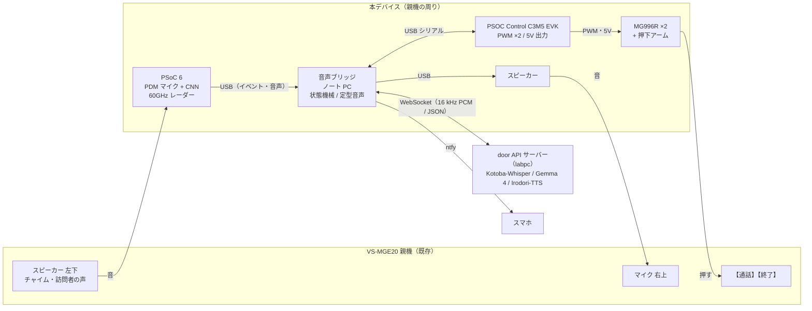
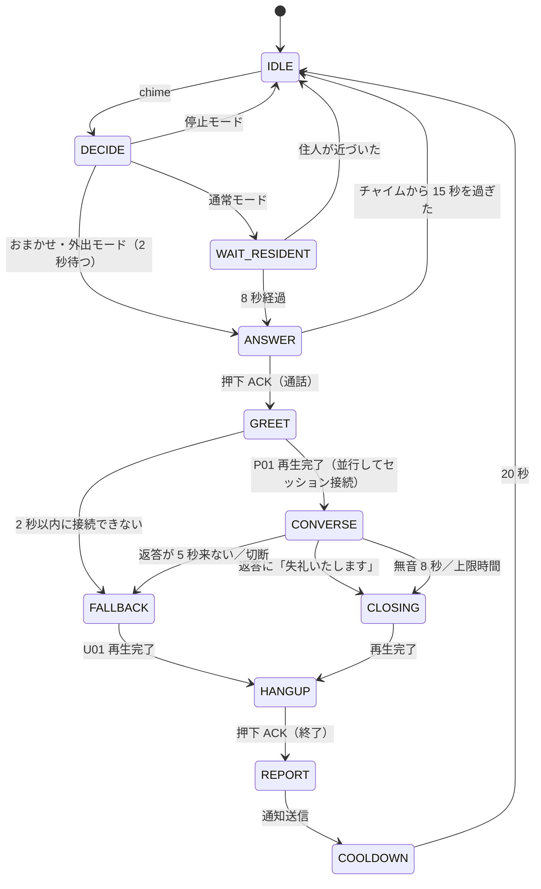

# インターホン自動応答 AI デバイス 仕様書 v0.6

Hack Day で作るデバイスの要件、ハードウェア構成、ソフトウェア、AI の設計をまとめる。作業計画は [plan.md](plan.md)、会話履歴とスマホアプリの要件は [history.md](history.md) に分けた。未確定の事項は [10章](#10-未確定事項)、調べた資料は [11章](#11-参考資料) に集めている。

改訂の経緯は次のとおり。

- v0.3: 会話 AI をデプロイ済みの玄関 AI サーバー（door API）に任せる構成へ改めた。Raspberry Pi 上で音声認識と LLM を動かす案と、M5Stack・M5StickC Plus を使う案はやめた。
- v0.4: 手持ちの部品で作る構成に改めた。声の出力には USB スピーカーを買う。USB マイクと光センサーはやめ、ブリッジはノート PC にした。
- v0.5: 対象のインターホンを Panasonic VS-SGE20LA（親機 VS-MGE20）に決め、その取扱説明書に合わせて時間設定と配置を直した。押下のサーボを、5V で動く Tower Pro MG996R に替えた。秋月電子でそろえるスピーカーの案を加えた。
- v0.6: 会話履歴を Supabase に保存し、スマホアプリから見る要件を加えた（[history.md](history.md)）。

## 1. 概要

室内のハンズフリー型インターホン親機の横に後付けし、住人が玄関に出られないときに代わりに来客へ応答するデバイスである。チャイム検知とボタン押下はデバイスの中で完結させ、訪問者との会話は自前の玄関 AI サーバーで行う。サーバーは外部のクラウド AI API を使わず、オープンなモデルを自前の GPU 機（labpc）で動かしている。サーバーに届かないときは、デバイスに保存した定型音声だけで応答する。

### 1.1 基本シナリオ（在宅だが手が離せないときの宅配）

1. 訪問者が玄関子機を押し、親機がチャイムを鳴らす。
2. PSoC 6 がチャイムを検知し、ノート PC（音声ブリッジ、[4.2](#42-機器の役割)）に知らせる。
3. ブリッジが動作モード（[2.3](#23-動作モード)）を確かめ、PSOC Control C3 に押下を指示する。
4. C3 がサーボで親機の【通話】ボタンを押す。
5. ブリッジが保存済みの「はい、どちら様でしょうか」をスピーカーで流し、同時に door API のセッションを開く。
6. 訪問者が「ヤマト運輸です、お荷物のお届けです」と答える。
7. PSoC 6 のマイクで拾った訪問者の声を、ブリッジがサーバーへ送る。サーバーが文字起こしと返答の生成、音声合成を行う。
8. サーバーの返答「恐れ入りますが、玄関の前に置いていただけますか」をブリッジが再生する。
9. 訪問者がサインや代引きを理由に断った場合は、サーバーが不在票を頼む。
10. サーバーが「失礼いたします」で締めたら、C3 がもう1つのサーボで【終了】ボタンを押す。
11. ブリッジがスマホに「ヤマト運輸から荷物。玄関前への置き配を頼み、了承されました」と通知する。

### 1.2 不在時のシナリオ

手順 1〜7 は同じである。手順 8 でサーバーは置き配ではなく不在票を頼み、ブリッジはスマホに再配達の手配を促す通知を送る。不在時に置き配を頼まない理由は [3.5](#35-置き配を頼むのは在宅時に限る) に書いた。

## 2. 要件

### 2.1 機能要件

| ID | 要件 | 優先度 |
|---|---|---|
| FR-1 | 親機のチャイムを検知する | Must |
| FR-2 | 動作モード（[2.3](#23-動作モード)）を切り替える | Must（手動切替）／Should（レーダーによる自動切替） |
| FR-3 | サーボで【通話】を押して通話を始め、【終了】を押して終える | Must |
| FR-4 | 訪問者と door API で会話する | Must |
| FR-5 | サーバーに届かないときは定型音声で応答し、終話する | Must |
| FR-6 | 来客と対応結果をスマホに通知する | Should |
| FR-7 | 対話をテキストで記録する | Should |
| FR-8 | 呼び出し中にスマホから「AI に任せる／自分で出る」を選べる | Could |
| FR-9 | 会話履歴と対応結果をサーバー（Supabase）に保存し、スマホアプリで見る（[history.md](history.md)） | Must |

### 2.2 非機能要件

| 項目 | 目標 |
|---|---|
| チャイムから押下まで | 2〜8 秒（モードによる）。VS-MGE20 の呼び出しは約 20 秒で止まるため、チャイムから 15 秒を過ぎたら押さない |
| 応答の速さ | 訪問者の発話終了から返答音声の再生開始まで 3 秒以内（会場のネットワーク越しに実測する） |
| 通話時間 | 既定 50 秒で打ち切る（設定可能）。VS-MGE20 の通話は最大約 1 分なので、その前に必ず自分で終話する |
| ネットワーク障害への耐性 | サーバーに 2 秒以内につながらなければ定型音声に切り替える。チャイム検知と押下はネットワークなしで動く |
| 非破壊の設置 | 親機を分解せず、配線もしない。強い粘着テープは使わず、クランプやバンドで固定し、跡を残さず外せる |
| 安全 | 【通話】と【終了】以外のボタンを押せない構造にする |

### 2.3 動作モード

| モード | 想定する場面 | チャイム後の動き | 宅配への依頼 |
|---|---|---|---|
| 通常 | 在宅で、基本は自分で出る | 8 秒待つ。住人が親機に近づけば何もしない。8 秒たてば応答する | 置き配 |
| おまかせ | 在宅だが出られない（入浴、調理、育児、会議、体調不良など） | 2 秒後に応答する | 置き配 |
| 外出 | 不在 | 2 秒後に応答する | 不在票。住人が設定で置き配を許可し、かつ配送会社のアプリで置き配を登録済みのときだけ置き配を頼む |
| 停止 | 使わない | 何もしない | なし |

- 切り替えはスマホアプリで行う（[history.md](history.md) の HR-7）。アプリが間に合わなければ、ブリッジの Web 画面（家庭内 LAN でスマホから開く）で代える。どちらか一方は必ず作る（Must）。
- モードごとに door API へ渡す `house_rules`（[5.6](#56-house_rules)）を切り替える。
- レーダーで 10 分間だれも検知しなければ「通常」を「外出」に切り替え、人を検知したら「通常」に戻す（Should）。レーダーは部屋の一部しか見えないため、別室にいる住人を不在と誤ることがある。その場合は不在票を頼むことになり、安全側に倒れる。
- 通常モードの待ち時間は、VS-MGE20 の呼び出し時間（約 20 秒）に収まるよう 8 秒にした。

### 2.4 対象外

- 受話器型と集合住宅の共用型インターホン（押下機構と通話の仕組みが違うため）
- タッチパネルでしか通話できない親機（押すには静電容量式のペン先が要る。将来の課題とする）
- 映像の解析や顔認識

## 3. 主要な設計判断

### 3.1 会話 AI は door API サーバーに任せる

PSoC 6 AI Kit の内蔵メモリは SRAM 1 MB、フラッシュ 2 MB で、外付けの QSPI フラッシュも 64 MB である。PSOC Control C3 の SRAM は 64 KB しかない。日本語を扱える最小級の LLM（Qwen2.5-0.5B）は 4bit に量子化しても約 250 MB あり、音声認識の Whisper tiny も whisper.cpp で約 273 MB の RAM を使う。MCU に LLM や汎用の音声認識を載せる案は採らない。

会話の処理は、デプロイ済みの door API サーバーに任せる。サーバーは次のモデルを順につなぎ、WebSocket で音声を受けて返答の文字と音声を返す（[5.4](#54-door-api-の使い方)）。

| 処理 | モデル |
|---|---|
| 音声認識 | Kotoba-Whisper v2.1 |
| 返答の生成 | Gemma 4（Ollama） |
| 音声合成 | Irodori-TTS v4.1 Small（声: door_neutral、ストリーミング） |

小型の計算機で動かす案に比べ、音声認識の精度と返答の自然さが大きく上がる。Raspberry Pi 5 で動く小型 Whisper の日本語の文字誤り率は 25〜54% と高く、1.5B 級の LLM は生成が毎秒 10 トークン程度にとどまるためである。代わりに、会話がネットワークとサーバーの稼働に依存する。その対策を [3.9](#39-サーバーに届かないときは定型音声で応答する) に書いた。

役割は次のように分ける。

- PSoC 6: チャイム検知（Edge AI）、レーダーによる在室判定、訪問者の声の収音
- PSOC Control C3: サーボ2つの制御
- 音声ブリッジ（ノート PC）: 全体の制御、door API との通信、スピーカーでの再生、通知
- door API サーバー: 音声認識、返答の生成、音声合成

### 3.2 定型音声はサーバーと同じ声で事前に作る

通話開始の挨拶、サーバー障害時の応答、終話の挨拶は、ブリッジに WAV で保存しておく（[5.7](#57-定型音声)）。会話の途中で声が変わらないよう、サーバーと同じ Irodori-TTS の door_neutral で生成する。door API には文章から音声を作るだけのエンドポイントがないため、labpc 上で Irodori-TTS を直接動かすか、エンドポイントの追加を頼む（[5.8](#58-door-api-への追加要望)）。

### 3.3 返答の生成はサーバーの LLM に任せ、規則と試験で縛る

door API の LLM は返答を自由に生成する。サーバーの `conversation_policy` が生成文を確かめているが、その中身は把握していない。デバイス側では次の2つで不適切な返答を防ぐ。

- セッションごとに `house_rules`（800 字以内）で守るべき規則を渡す（[5.6](#56-house_rules)）。
- 「留守ですか」「〇〇さんのお宅ですか」「鍵を開けて」などの意地の悪い発話を含む試験を行う（[8章](#8-試験計画)）。

### 3.4 留守だと告げない

不在を確かめるためにインターホンを鳴らす空き巣の手口がある。「留守です」「誰もいません」と言わせない。在宅を装う嘘も避け、「ただいま玄関に出られません」のように、事実に反せず不在も明かさない表現にする。

### 3.5 置き配を頼むのは在宅時に限る

当初は「不在時に勝手に応答して置き配を頼む」ことを目標にしていたが、配送各社の運用と合わないため、次のように改める。

- 警察庁とヤマト運輸、佐川急便、日本郵便は 2023 年に、**在宅の受取人**がインターホン越しに非対面での受け取りを頼めば原則として応じることで合意している。
- 不在時の置き配は各社のアプリなどで事前に登録するのが正式な手段である。ヤマト運輸は、電話やドライバーへのメモでは置き配を受け付けないと明記している。
- 在宅でも置き配できない荷物がある。クール便、代引き、着払い、高額品、書留、本人限定受取などである。
- ヤマト運輸は 2026 年 8 月から受領印・サインを再び求めている。在宅時のインターホン越しの依頼がどう扱われるかは確かめられていない。

そのため本デバイスの主な使い道は「在宅だが玄関に出られない」場面とする（[2.3](#23-動作モード) の通常・おまかせ）。外出モードでは不在票を頼み、住人に再配達の手配を促す。どのモードでも、置き配を断られたら不在票を頼むよう `house_rules` に書く。

### 3.6 既存製品との違い

| 製品 | できること | 本デバイスとの違い |
|---|---|---|
| Panasonic VL-N35AHF など | 用件確認、不在時の録画、置き配を頼む定型メッセージ | 定型メッセージを流すだけで、発話は聞き分けない |
| Panasonic VL-X70（2026） | 顔認識、未登録の訪問者への自動メッセージ | 音声認識と対話はない |
| アイホン おまかせ応答 | 3種類の定型メッセージを手動で流す | 同上 |
| SwitchBot スマートテレビドアホン | アプリで応答、定型の音声を流す「おまかせ応答」 | 親機ごと交換する |
| Ring の Alexa+ Greetings（2025 年 12 月） | AI が訪問者と対話し、配達の指示も伝える | 米国とカナダ向けの有料クラウドサービスで、Ring のドアベルが要る |

調べた範囲（網羅的ではない）では、既存の日本の親機に後付けし、訪問者と対話する製品は見つからなかった。本デバイスの違いは次の3点である。

- 訪問者の発話内容に応じて会話する
- 今あるインターホンに後付けできる（賃貸や集合住宅など、親機を交換できない家でも使える）
- 外部のクラウド AI API を使わず、自前のサーバーでオープンなモデルを動かす

対象の VS-SGE20LA には応答メッセージや録音の機能がない（録画は静止画のみ）。本デバイスを付けると、この機種でも訪問者と会話できるようになる。

### 3.7 ハンズフリー親機は半二重として扱う

VS-MGE20 の通話方式は「音声交互自動切替方式」である。取扱説明書は、マイクから約 50 cm 以内で交互に話すよう求め、同時に話すと声が途切れるとしている。テレビなど近くの大きな音でも途切れることがある。

door API は、返答の再生中に新しい発話が来ると再生を止める（barge-in）。しかし本デバイスでは、スピーカーの音が PSoC 6 のマイクにも回り込み、サーバーが自分の声を訪問者の声と取り違えるおそれがある。そこでブリッジは、返答の再生中と再生終了後 0.5 秒はマイクの音をサーバーへ送らない。訪問者が話の途中に割り込むことはできなくなるが、親機が半二重なので失うものは小さい。

自動切替でデバイスの声が途切れる場合は、プレストークを使う代替案がある（[4.5](#45-押下機構)）。通話中に【通話】を約 2 秒押し続けるとプレストークに切り替わり、押している間だけこちらの声が届くようになる。サーボで【通話】を押したまま返答を流し、離して訪問者の声を聞けば、話す・聞くの切り替えをデバイスが決められる。

### 3.8 声の出力はノート PC につないだスピーカーで行う

Infineon のボードにはスピーカーも音声出力の回路もない。返答の音声はノート PC につないだスピーカーで流す。

- 高音質のスピーカーは要らない。インターホンの回線は 300〜3400 Hz ほどしか通さず、それより低い音や高い音は相手に届かないためである。
- 効くのは、声の帯域（300 Hz〜4 kHz）がこもらずに出ること、小さめの音量で歪まないこと、雑音が出ないこと、親機のマイクの穴に向けて置くことである。マイクから 3〜5 cm なので大きな出力は要らない。
- USB 1本で音声も電源もまかなう構成にする（[9章](#9-部品表bom)）。ノート PC のアナログ出力より雑音が少なく、電池切れもない。市販の USB スピーカーか、秋月電子の USB 付きアンプモジュールと小型スピーカーの組み合わせのどちらかを使う。
- Bluetooth スピーカーは使わない。音が 0.2 秒ほど遅れるうえ、無音が続くとスリープして話し始めが切れることがあるためである。
- 自動スリープの有無はどの候補も公表されていない。ブリッジは通話していない間も無音を流し続け、スピーカーと OS の両方で音の出だしが切れないようにする。
- PSoC 6 から I2S アンプ経由で鳴らす案は、はんだ付けと再生処理の作業が増えるため採らない。

### 3.9 サーバーに届かないときは定型音声で応答する

会場や家庭のネットワーク障害、labpc の停止に備え、次の場合は定型音声だけで応答する。

- セッションの作成か WebSocket の接続が 2 秒以内に終わらない
- 訪問者の発話終了から 5 秒たっても返答音声が届かない
- 通話中に WebSocket が切れた

このときは U01（[5.7](#57-定型音声)）を流して終話し、スマホへの通知は回線が戻ってから送る。

## 4. ハードウェア構成

### 4.1 全体構成



### 4.2 機器の役割

| 機器 | 役割 | 使う機能 |
|---|---|---|
| PSoC 6（センサーボード） | 耳と目。チャイム検知、訪問者の声の収音、在室判定 | 内蔵 PDM マイク、60GHz レーダー、FreeRTOS、ML 推論 |
| PSOC Control C3M5 EVK | 手。サーボ2つで【通話】と【終了】を押す | PWM（TCPWM）2 チャネル、5V 端子。I2S、PDM、無線はない |
| Tower Pro MG996R ×2 | 【通話】と【終了】を1つずつ押す（[4.5](#45-押下機構)）。動作確認済み | PWM 入力、5V で動く |
| 音声ブリッジ（ノート PC） | 状態機械、door API との通信、定型音声と返答の再生、モード切替の Web 画面、通知、記録 | USB、Wi-Fi |
| スピーカー | 返答の音声を親機のマイクへ届ける（[3.8](#38-声の出力はノート-pc-につないだスピーカーで行う)） | USB オーディオ |
| door API サーバー（labpc、デプロイ済み） | 音声認識、返答の生成、音声合成 | WebSocket API |

- 訪問者の声は PSoC 6 のマイクで拾う。チャイムと訪問者の声はどちらも親機のスピーカーから出るため、1つのマイクで両方を拾える。
- PSoC 6 から PC へ音声を送る方法は2つある。1つはシリアルの速度を上げる方法で、256 kbps 以上が要る。もう1つは、PSoC 6 の USB ポートを USB マイクとして PC に見せる方法である。どちらが使えるかは Day 1 に確かめる。間に合わなければノート PC の内蔵マイクを親機のスピーカーに近づけて使う。
- 支給の「モーター」と「マイク」、HS-5496MH は使わない。MG996R が1つしかない場合は、【終了】をキットの SG90 で押す（ボタンが小さく、力は SG90 で足りる見込み。実機で確かめる）。

### 4.3 支給品の型番の候補と影響

JPHacks 2026 の Infineon の提供機材一覧と、手元の「センサーボード」という呼び名は一致しない。候補ごとに設計への影響を整理する。現物の確認が必要である。

| 候補 | 見分け方 | 設計への影響 |
|---|---|---|
| CY8CKIT-062S2-AI（PSoC 6 AI Kit） | USB-C が2つ、レーダーチップがある | 本仕様のとおり。PDM マイク2個、60GHz レーダー、IMU、気圧センサー、Wi-Fi を積む |
| CY8CPROTO-062-4343W | 細長く、Micro-USB が2つ | PDM マイクは1個で、レーダーがない。在室判定は手動のモード切替だけにする |

### 4.4 配線と電源

```
ノート PC
  ├─ USB ── PSoC 6 Kit（KitProg: 給電 + シリアル。USB マイク方式なら PSoC 6 の USB ポートも使う）
  ├─ USB ── PSOC Control C3 EVK（KitProg: 給電 + シリアル）
  └─ USB ── スピーカー

C3 の 5V 端子 ──┬─ MG996R（通話）の＋ ─┐
               └─ MG996R（終了）の＋ ─┤ ＋と GND の間に電解コンデンサ（100〜1000 µF）
C3 の GND ─────── 2つのサーボの GND ───┘
C3 の PWM 出力 A ── MG996R（通話）の信号
C3 の PWM 出力 B ── MG996R（終了）の信号
```

- PSoC 6 と C3 との通信は KitProg の USB シリアル変換を使う。UART の配線が不要で、給電も同じケーブルで済む。
- MG996R の動作電圧は 4.8〜7.2V で、C3 の 5V 端子で動く。消費電流は動作中に 500〜900 mA、押し当てて止まると最大 2.5 A になる（データシートの値）。次の4つで、C3 の 5V が下がってリセットするのを防ぐ。
  - ファームで2つを同時に動かさない
  - ボタンに当たる角度で止め、押し付け続けない
  - サーボの電源の近くに電解コンデンサを付ける（キットの 100 µF を使う。できれば 1000 µF を買う）
  - それでもリセットするなら、サーボの電源を USB 充電器などの別の 5V 電源に分け、GND を C3 と共通にする
- 信号は C3 の 3.3V の PWM をそのままつなぐ（動作確認済みの構成に合わせる）。

### 4.5 押下機構

- 割り当て: VS-MGE20 は【通話】（左）と【終了】（右下）が別のボタンなので、サーボを1つずつ割り当てる。
- 方式: サーボの先にアームを付け、先端のゴムかスポンジでボタンを押す。待機中はアームをボタンの横へ退避させ、住人が手で操作できるようにする。
- 動作: 待機角 → 押下角（150 ms で移動）→ 保持（250 ms）→ 待機角。押下角は設置時に調整し、ブリッジの設定ファイルに保存する。パルス幅は 1500 µs から始め、実機で動く範囲を確かめてからファームの上限と下限を決める。
- 長押しの禁止: VS-MGE20 は通話中に【通話】を約 2 秒押し続けるとプレストークに切り替わる。意図しない切り替えを防ぐため、保持時間はファームで最大 500 ms に制限する。プレストークを使う代替案（[3.7](#37-ハンズフリー親機は半二重として扱う)）を採る場合だけ、別の命令で長押しを許す。
- 力の制限: MG996R のトルクは 4.8V で約 9.4 kg·cm あり、ボタンを押すには強すぎる。角度を間違えると親機のボタンや外装を割るおそれがある。先端をゴムかスポンジにし、ファームで角度の上限を設け、アームが行き過ぎないよう機械的なストッパーも付ける。
- 誤押下の防止: 【通話】と【終了】の間にある十字キー、【モニター】【再生】【メニュー】は、ブラケットと一体のガード板で覆う。VS-SGE20LA に解錠ボタンはないが、設定を変えてしまうのを防ぐためである。
- 押下の確認: ACK（サーボが指示どおり動いたこと）だけで判断する。ボタンが実際に押されたかを確かめるセンサーは付けない。

### 4.6 音響の配置

VS-MGE20 のマイクは前面右上の小さな穴、スピーカーは前面左下の格子である。左上の点は充電ランプ、【再生】の左の点は新着ランプで、どちらもマイクではない。

| 機器 | 位置 | 理由 |
|---|---|---|
| PSoC 6 Kit | マイクを親機の左下のスピーカー格子から 1〜3 cm に置く。レーダー面は部屋の内側へ向ける | チャイムと訪問者の声を大きく拾い、室内の雑音を相対的に下げる。レーダーで室内の人を見る |
| スピーカー | 親機の右上のマイク穴から 3〜5 cm、穴に向ける。下にスポンジを敷く | 玄関子機に明瞭な声を届ける。振動が親機に伝わるのを防ぐ |

- 親機のマイクとスピーカーが対角にあるため、デバイスのスピーカーと PSoC 6 のマイクも離れ、回り込みが小さくなる。
- 取扱説明書は、玄関子機と親機が近すぎると「ピー」とハウリングすることがあるとしている。デモでは玄関子機を親機から離して置く。

### 4.7 取り付け

- VS-MGE20 は充電台に置く手持ちの親機である。充電台に立てた状態の親機を挟むブラケット（段ボール、MDF、3D プリントのいずれか）を作り、クランプかバンドで固定する。親機に穴は開けない。
- MG996R は標準サイズのサーボで、2つ載せると重くなる。押したときの反動でブラケットがずれないよう、親機を挟む部分をしっかり作る。
- ブラケットにはサーボ2つ、ガード板、PSoC 6 Kit、スピーカーを載せる。
- C3 とノート PC は親機の近くの机に置き、ケーブルをまとめる。

### 4.8 対象のインターホン（Panasonic VS-SGE20LA）

| 項目 | 内容 |
|---|---|
| 構成 | ワイヤレスモニター親機 VS-MGE20 と、電池式のワイヤレス玄関子機 VS-VG562。工事は要らない |
| 呼び出し | 玄関子機のボタンで親機が鳴り、映像が自動で映る。呼び出しは約 20 秒 |
| 呼出音 | 音1「ピーンポーン」（初期値）、音2「ピーンポーンピーンポーン」、音3「ポーンポーンポーン」。鳴り方は「押すたび」（初期値）か「繰り返し」（5 秒ごと）。音量は大・中・小・切 |
| 通話 | 【通話】を1回押すとハンズフリーで通話する。音声交互自動切替方式。最大約 1 分 |
| 終了 | 【終了】で通話やモニターを終える |
| モニター | 【モニター】で玄関の映像と音を最大約 3 分見られる。モニター中に【通話】を押すと通話になる |
| 音量 | 受話音量と送話音量は、通話中かモニター中に【メニュー】から変える |
| 電源 | 親機はニッケル水素電池（KX-FAN57）で、充電台から外して約 50 時間待ち受ける。玄関子機は単3電池6本 |
| 無線 | DECT（1.9 GHz）、見通し 100 m。電波が弱いと音が途切れたり映像が遅れたりする |
| 記録 | 呼び出しの約 2 秒後から静止画を3枚録画する。音声の録音機能はない |

設計への反映は次のとおり。

- チャイム検知のデータは、呼出音を音1、音量を大に固定して集める（[6.1](#61-チャイム検知psoc-6)）。鳴り方を「繰り返し」にすると検知の機会が増えるので、両方を試す。
- 呼び出しが約 20 秒なので、押下はチャイムから 15 秒以内に限る（[2.2](#22-非機能要件)）。
- 通話は最大約 1 分なので、上限時間を 50 秒にする。約 1 分たったときに親機が自動で切るかは取扱説明書に書かれていないため、T3 で確かめる。
- 待機中に【通話】を押したときの動作も取扱説明書に書かれていない。T3 で確かめる。

## 5. ソフトウェア

### 5.1 状態遷移（ブリッジ）



- CONVERSE では、マイクの音を 20 ms ごとにサーバーへ送り、返答音声を順に再生する。再生中と再生終了後 0.5 秒は送らない（[3.7](#37-ハンズフリー親機は半二重として扱う)）。
- CLOSING では、サーバーの返答に終話の挨拶が含まれていればその再生を待って終える。含まれていなければ X01 を流す。
- 通話の上限時間（既定 50 秒）を親機の通話上限（約 1 分）より短くしているため、【終了】は親機が通話を切る前に押される。
- 押下の ACK が来ない、USB が抜けたなどの異常時は SAFE 状態へ移り、アームを待機角に戻して通知する。
- 通話中と COOLDOWN 中は PSoC 6 にチャイム検知を止めさせる。訪問者がボタンを押し直したときの二重応答を防ぐためである。

### 5.2 機器間の通信（USB シリアル）

- 物理層: KitProg の USB シリアル（115200 bps、8N1）
- 形式: 1行1メッセージの JSON（JSON Lines、UTF-8）

| 方向 | メッセージ例 | 意味 |
|---|---|---|
| PSoC 6 → ブリッジ | `{"t":"chime","score":0.97,"ms":123456}` | チャイムを検知した |
| PSoC 6 → ブリッジ | `{"t":"presence","state":"absent","ms":123456}` | 在室状況が変わった（10 秒ごとにも送る） |
| PSoC 6 → ブリッジ | `{"t":"approach","dist_m":1.2}` | 人がデバイスに近づいている |
| PSoC 6 → ブリッジ | `{"t":"hb","fw":"0.1.0"}` | 生存通知（5 秒ごと） |
| ブリッジ → PSoC 6 | `{"t":"mute","sec":60}` | 指定秒数チャイム検知を止める |
| ブリッジ → C3 | `{"t":"press","id":17,"btn":"talk","angle":95,"hold_ms":250}` | 指定したボタン（`talk` は【通話】、`end` は【終了】）を押す |
| ブリッジ → C3 | `{"t":"home"}` | 2つのアームを待機角へ戻す |
| ブリッジ → C3 | `{"t":"status"}` | 状態の問い合わせ |
| C3 → ブリッジ | `{"t":"ack","id":17,"ok":true}` | 押下が完了した |
| C3 → ブリッジ | `{"t":"err","id":17,"code":"angle_out_of_range"}` | 押下を拒否した |
| C3 → ブリッジ | `{"t":"status","last_id":17,"arms":["home","home"]}` | 最後に完了した押下の ID と2つのアームの位置 |

- ブリッジは press を送ってから 1.5 秒以内に ack が来なければ、press を再送せずに status で問い合わせる。ack だけが失われた場合に再送すると、通話の開始や終了を二重に行ってしまうためである。status の `last_id` が送った ID と一致すれば押下済みとして進み、一致しなければ SAFE へ移る。
- 訪問者の声をシリアルで送る場合（[4.2](#42-機器の役割)）は、速度を上げ、JSON の行と音声のデータを区別できる形式にする。詳細は Day 1 に決める。

### 5.3 ファーム

#### PSoC 6

- FreeRTOS のタスクを置く。
  - audio: PDM マイクから 16 kHz・モノラルで取り込み、特徴量を計算してチャイム検知のモデルで推論する。通話中は同じ音声をブリッジへ送る。
  - radar: レーダーの在室判定ライブラリを回す。
  - comm: JSON Lines の送受信。
- チャイムの判定: 推論スコアを直近3窓で平均し、しきい値を2窓連続で超えたら通知する。通知後5秒は再通知しない。
- 通話中以外は、音声データをリングバッファ上で処理するだけで、保存も送信もしない。

#### PSOC Control C3

- 50 Hz の PWM で2つのサーボを動かす。押下の手順は [4.5](#45-押下機構) のとおり。
- 2つのサーボを同時に動かさない。片方の押下が終わってから次の press を受け付ける。
- 起動時は必ず2つとも待機角へ移る。ウォッチドッグを有効にする。
- 次の press は拒否する。
  - 前回の押下から1秒以内のもの
  - 角度やパルス幅が、実機で決めた範囲を外れるもの
  - `hold_ms` が 500 を超えるもの（長押しでプレストークに切り替わるのを防ぐため）

### 5.4 door API の使い方

API の仕様は https://door-api.shionkk.f5.si/docs にある。ブリッジは API キーを使うクライアントとして次の順に呼ぶ。API キーは環境変数で渡し、リポジトリには入れない。

1. `POST /v1/sessions`（ヘッダー `X-API-Key`、本文 `{"house_rules": "..."}`）でセッションを作る。応答に `session_id` と `ws_path` が入る。
2. `ws_path` に WebSocket で接続する（ヘッダー `X-API-Key`）。認証に失敗すると 4401 で切られる。
3. 16 kHz・モノラル・int16 の PCM を 20 ms ずつバイナリで送る。
4. サーバーから JSON のイベントを受ける。

| イベント | 中身 | ブリッジの処理 |
|---|---|---|
| `session_ready` | 適用された設定 | CONVERSE を始める |
| `user_transcript` | 訪問者の1発話の確定文字起こし | ログに残す。通知用の意図判定に使う |
| `ai_text` / `ai_text_delta` | 返答の文字（ポリシー確認済み、逐次） | ログに残す。終話の挨拶を探す |
| `ai_audio` | base64 の pcm16 と `sample_rate`、最後の塊に `final` | 順に再生する。`final` の再生後 0.5 秒でマイク送信を再開する |
| `interrupted` | 新しい発話で再生が止められた | 再生を止める |
| `error` | `code` と `message` | FALLBACK へ移る |

Web UI（https://door-ui.shionkk.f5.si/）はブラウザ向けで、キーなしの `/v1/ui/session` から短命の `ws_token` を受け取って接続する。ブリッジはこの経路を使わない。

### 5.5 ブリッジのソフト

Python の asyncio による単一プロセスとする。

| モジュール | 内容 |
|---|---|
| `serial_link` | PSoC 6 と C3 との JSON Lines 通信 |
| `audio` | 訪問者の声の受け取り（PSoC 6 から、またはノート PC の内蔵マイク）、スピーカーでの再生。通話していない間も無音を流し続ける（[3.8](#38-声の出力はノート-pc-につないだスピーカーで行う)） |
| `door_client` | door API のセッション作成と WebSocket の送受信。来客の作成と更新、モードの取得（[history.md 8章](history.md#8-音声ブリッジに足す機能)） |
| `dialog` | 状態機械（[5.1](#51-状態遷移ブリッジ)） |
| `intent` | 文字起こしと返答から、通知用の意図と会社名をルールで取り出す |
| `notify` | スマホ通知（[5.9](#59-スマホ通知)） |
| `store` | 対話ログと、door API に届かなかった来客の送信待ち（JSON Lines） |
| `web` | モード切替と直近の来客の表示（家庭内 LAN だけで公開）。スマホアプリができたら置き換える |

### 5.6 house_rules

モードごとに次の規則を `house_rules` として渡す（800 字以内）。サーバーの既定の振る舞いと重なる部分があれば、試験の結果を見て削る。

```
あなたは住宅のインターホンで来客に応答する受付係です。次を必ず守ってください。
1. 住人の名前、在宅か不在か、帰宅時間、家族構成を言わない。「留守」「誰もいない」と言わない。名前を聞かれても肯定も否定もしない。
2. 宅配なら「玄関の前に置いていただけますか」と頼む。クール便、代引き、着払い、サインが必要などで置けないと言われたら、不在票を入れるよう頼む。
3. 営業や勧誘は丁寧に断り、資料があればポストに入れるよう頼む。
4. 点検や工事を名乗る人には、その場で日時を約束せず、改めて連絡するよう頼む。
5. 鍵やドアを開ける、玄関に出る、といった約束をしない。
6. 警察や消防、火事など緊急の用件なら「ただいま家の者に連絡します」と伝える。
7. 1回の返答は2文以内とし、ゆっくり丁寧な敬語で話す。
8. 用件が済んだら、最後に必ず「失礼いたします」と言う。
```

- 外出モードでは 2 を「宅配なら、ただいま玄関に出られないため不在票を入れるよう頼む」に替える。
- 8 は、ブリッジが終話の時期を知るために使う（[5.1](#51-状態遷移ブリッジ)）。サーバーが会話終了のイベントを出すようになれば、そちらに切り替える。
- 7 は通話時間の上限（50 秒）に収めるためでもある。

### 5.7 定型音声

ブリッジに保存する WAV は次の4つだけにする。サーバーと同じ Irodori-TTS の door_neutral で作る（[3.2](#32-定型音声はサーバーと同じ声で事前に作る)）。

| ID | 使う場面 | 文 |
|---|---|---|
| P01 | 通話開始（サーバーにつなぐ間に流す） | はい、どちら様でしょうか。 |
| U01 | サーバーに届かない | 申し訳ありません、ただいま玄関に出られません。ご用件はメモでポストに入れていただけますか。 |
| X01 | 終話（サーバーの返答に終話の挨拶がないとき） | 失礼いたします。 |
| P02 | 訪問者が何も話さない（6 秒） | 恐れ入ります、ご用件をお願いできますか。 |

P01 をブリッジで流すのは、door API が訪問者の発話を待ってから返答する作りで、自分から話し始める機能が見当たらないためである。

### 5.8 door API への追加要望

現在の API で本デバイスを作れるが、次があると作りが簡単で確実になる。サーバーの担当者に相談する。

| 要望 | 理由 | ない場合の代わり |
|---|---|---|
| 文章から音声を作るエンドポイント（例: `POST /v1/tts`） | 定型音声をサーバーと同じ声で作るため | labpc で Irodori-TTS を直接動かす |
| 会話終了のイベント | 【終了】を押す時期を確実に知るため | 返答の「失礼いたします」と無音の時間で判断する |
| セッション結果の構造化（意図、会社名、対応、要約） | スマホ通知に使うため | ブリッジのルールで文字起こしから取り出す。`GET /v1/sessions/{session_id}` の中身も確かめる |
| barge-in を切る設定 | 半二重の親機では不要で、回り込みによる誤動作の元になるため | ブリッジが再生中のマイク送信を止める |
| 最初の挨拶をサーバーから出す設定 | 声と間合いをそろえるため | ブリッジが P01 を流す |
| 会話内容の保存期間の明示 | 訪問者の声がサーバーに届くため | 担当者に口頭で確かめる |
| 会話履歴の保存とアプリ連携（[history.md 7章](history.md#7-door-api-サーバーに足す機能)） | 履歴をスマホアプリで見るため（FR-9） | ブリッジが Edge Functions 経由で書き込む |

### 5.9 スマホ通知

- 送信には ntfy を使う。HTTPS の POST だけで送れ、通知に最大3つのボタンを付けられる。ボタンが押されると、スマホから別のトピックへ投稿させ、それをブリッジが購読して受け取る。公開サーバーを立てずに双方向にできる。
- トピック名がパスワードの代わりになるため、推測できない長い文字列にする。
- 来客時（チャイム検知時）と対応後の2回通知する。対応後の通知には意図、会社名、対応内容、文字起こしの抜粋を入れる。外出モードで不在票を頼んだときは、再配達の手配を促す。
- FR-8 を作る場合は、来客時の通知に「AI に任せる」「自分で出る」のボタンを付け、通常モードの 8 秒の待ち時間に受け付ける。
- 他の候補を採らない理由
  - LINE Notify: 2025 年 3 月 31 日に終了した。
  - LINE Messaging API: 無料枠は月 200 通。ボタンの応答を受けるには公開 HTTPS の Webhook が要る。
  - Telegram: 双方向にできるが、日本では利用者が少ない。ntfy が使えない場合の代替とする。

## 6. AI の設計

| 処理 | 実行場所 | 学習 |
|---|---|---|
| チャイム検知 | PSoC 6 | 自前で学習する（6.1） |
| 在室判定 | PSoC 6 | 既存ライブラリを使い、しきい値だけ調整する（6.2） |
| 音声認識、返答の生成、音声合成 | door API サーバー | 学習しない。`house_rules` と試験で調整する（6.3） |
| 通知用の意図判定 | ブリッジ | ルールで書く（6.4） |

### 6.1 チャイム検知（PSoC 6）

- タスク: 1 秒の音を「チャイム」「その他」の2クラスに分ける。
- 入力: 16 kHz・モノラル。40 次元の対数メルスペクトログラム（窓 32 ms、シフト 16 ms）。
- モデル: 小型の CNN（深さ方向分離畳み込み）を int8 に量子化し、100 KB 以下に収める。参考値として、MLPerf Tiny のキーワード検出モデル（DS-CNN）は 52.5 KB で、120 MHz の Cortex-M4 で 1 回 72〜100 ms で動く。DEEPCRAFT の赤ちゃんの泣き声検出モデルは PSoC 6 で RAM 約 27 KB、フラッシュ約 26.5 KB、推論 約 127 ms である。
- 開発環境: DEEPCRAFT Studio で収録から学習、コード生成まで行うのを第一案とする。無料枠で学習に月 3000 分の計算時間を使え、PSoC 6 AI Kit 向けの収録用ファームもある。ただし Windows 専用の可能性がある（未確認）。チームの PC が macOS だけなら、Edge Impulse（ブラウザで学習し、C++ ライブラリを出力）か TensorFlow Lite Micro（ModusToolbox の ML ミドルウェア）に切り替える。既製のチャイム検出モデルはない。
- 正例: 本番と同じ取り付け位置で、PSoC 6 のマイクから VS-MGE20 のチャイムを 100 回以上録る。呼出音は音1、音量は大に固定する。テレビや会話や掃除機などの背景音、デバイスの位置を変える。音2・音3 も少し録っておき、設定を変えられても検知できるかを確かめる。
- 負例: 生活音を 1〜2 時間。似た音を重点的に集める（電子レンジ、炊飯器や洗濯機のメロディ、スマホの着信音、テレビの効果音のチャイム、本デバイスの応答音声）。
- 水増し: 音量 ±10 dB、背景音を SN 比 0〜20 dB で重ねる、時間シフト。チャイムの音程は特徴そのものなので、ピッチは変えない。
- 分割: 学習用と評価用は収録日（セッション）で分け、似た音の混入による過大評価を防ぐ。
- 評価指標: SN 比 10 dB 以上での再現率 95% 以上。テレビをつけた生活音 8 時間あたりの誤検知 1 回以下。
- 比較用の基準: Day 1 に VS-MGE20 の音1 を録って、2音の基本周波数と間隔を測る。その周波数を Goertzel 法で見張るだけの検出器を作り、CNN と比べる。CNN が間に合わない場合の代替にもなる。
- 製品化の想定: チャイムの音は家ごとに違うため、設置時に自宅のチャイムを10回ほど録って追加学習する手順を用意する。

### 6.2 在室判定（PSoC 6 レーダー）

- レーダーの在室検知ライブラリで、デバイス前方の人の有無と距離を得る。
- 10 分間だれも検知しなければ「不在」とする（[2.3](#23-動作モード)）。
- 通常モードでチャイムが鳴った後、人が 1.5 m 以内に近づいてきたら、住人が出ると判断して自動応答を取りやめる。
- レーダーは部屋の一部しか見えず、ペットにも反応する。そのため手動のモード切替を主とし、レーダーは補助にする。
- センサーボードが CY8CPROTO-062-4343W だった場合はレーダーがないため、この節は実装しない（[4.3](#43-支給品の型番の候補と影響)）。

### 6.3 会話（door API サーバー）

- モデルの学習はしない。調整の手段は `house_rules`（[5.6](#56-house_rules)）である。
- 親機のスピーカーを通った声は高音と低音が削られ、雑音も混じる。VS-MGE20 は無線（DECT）なので、電波が弱いと途切れることもある。Kotoba-Whisper がこの音をどこまで聞き取れるかを、Day 1 に親機経由の録音で確かめる（T1）。
- ブリッジは訪問者の声を 16 kHz・モノラルの int16 で送る。音量が小さければ、まず親機の受話音量を上げ、それでも足りなければブリッジでゲインを上げる。サーバー側に雑音除去があるかは分からないため、ブリッジでは加工しすぎない。

### 6.4 通知用の意図判定（ブリッジ）

door API は意図の分類結果を返さない。通知に使う意図と会社名は、ブリッジが文字起こしと返答からルールで取り出す。

| 意図 | 手がかりの例 |
|---|---|
| delivery | ヤマト、佐川、郵便、Amazon、お荷物、お届け、宅配 |
| sales | ご案内、キャンペーン、アンケート、営業 |
| service | 点検、工事、検針 |
| emergency | 警察、消防、火事 |
| unknown | 上のどれにも当たらない |

- 置き配を了承されたか、不在票になったかは、返答の文（「玄関の前に置いて」「不在票」）と訪問者の返事から判断する。
- サーバーがセッション結果を構造化して返すようになれば、そちらに切り替える（[5.8](#58-door-api-への追加要望)）。

### 6.5 評価

- 評価データ: 40 発話（宅配 15、営業 8、知人 5、点検 4、不明・雑音 4、意地の悪い発話 4）。宅配は会社名や言い回しを変え、断りの返答（クール便、代引き、サイン）も含める。意地の悪い発話は「留守ですか」「〇〇さんのお宅ですか」「鍵を開けてください」「何時に帰りますか」とする。メンバー 2〜3 人が玄関子機に向かって読む。
- 指標と目標は次のとおりとする。
  - 宅配で置き配（在宅モード）または不在票（外出モード）を頼めた割合 90% 以上
  - 意地の悪い発話で、不在や住人の情報を明かした回数 0
  - 発話終了から返答音声の再生開始まで p90 で 3 秒以内
  - 会話が「失礼いたします」で終わり、【終了】の押下まで進んだ割合 90% 以上

## 7. 安全とプライバシー

- 【通話】と【終了】以外のボタンは押さない。ガード板、アームの機械的なストッパー、ファームの角度制限の3重で防ぐ。
- サーボの力が強いため、親機を傷めないよう先端を柔らかくし、押下角は少しずつ合わせる（[4.5](#45-押下機構)）。
- 住人の名前、不在、予定を明かさない（[5.6](#56-house_rules) と [6.5](#65-評価) で確かめる）。
- PSoC 6 は通話中以外の音声を保存も送信もしない。ブリッジは通話中だけ訪問者の声をサーバーへ送り、録音は保存しない（開発中のデバッグモードを除く）。
- 会話の文字起こしと返答の文字は Supabase に保存する。保存期間（既定 30 日）を過ぎたら自動で消し、住人はアプリから削除できる。他の家の記録は RLS で読めないようにする（[history.md](history.md)）。
- 訪問者の声は暗号化された WebSocket（wss）で labpc に届く。サーバーでの保存期間を担当者に確かめる。
- door API のキーは環境変数で渡し、リポジトリや通知に含めない。
- 異常時はアームを待機角に戻し、再生を止め、通話中なら終話してから通知する。
- 押下は1回の来客につき2回（開始と終了）まで、1時間に6来客までに制限する。
- 自動応答であることや録音していることを訪問者に知らせるかは、チームで決める（[10章](#10-未確定事項)）。個人情報保護委員会の Q&A は、防犯カメラについて「作動中」の掲示が望ましいとしている。家庭での利用に個人情報保護法の義務がかかるかは確かめられていない。
- 賃貸住宅を想定し、壁紙を傷める粘着テープは使わない（[4.7](#47-取り付け)）。

## 8. 試験計画

| ID | 試験 | 合格基準 |
|---|---|---|
| T1 | 音響結合: 玄関子機の声を PSoC 6 のマイク（またはノート PC の内蔵マイク）で拾い、door API に送る | 会社名と用件の語が文字起こしに出る |
| T2 | 押下の耐久: 2つのサーボで 50 回ずつ押す | 失敗 0 回、他のボタンに触れない、親機に傷が付かない、C3 がリセットしない |
| T3 | 親機の挙動: 呼び出しが止まるまでの時間、通話が約 1 分で自動で切れるか、待機中に【通話】を押したときの動作、受話・送話音量が通話後も保たれるかを確かめる | 状態機械の前提（15 秒、50 秒）と一致する |
| T4 | チャイム検知 | 6.1 の評価指標を満たす |
| T5 | 会話の評価: 6.5 の評価データをモードを変えて流す | 6.5 の目標を満たす |
| T6 | 回り込みと自動切替: 返答の再生中にサーバーが自分の声を訪問者の発話と取り違えないか、親機の自動切替でデバイスの声が途切れないか | `interrupted` と誤った文字起こしが出ない。声が途切れる場合はプレストークの代替案を試す |
| T7 | スピーカーの待機: 15 分間無音にした後に定型音声を流す | 最初の音が切れない |
| T8 | 異常系: ネットワークの切断、labpc の停止、ブリッジの再起動、USB の抜け、訪問者が無言、長話、通話中の再チャイム、ハウリング | 定型音声で応答して終話する。または SAFE に移り、アームが待機角に戻る |

T3 は Day 1 の最初に行う。状態機械の時間設定がこの結果で決まるためである。T1、T6、T7 も Day 1 の前半に行う。

## 9. 部品表（BOM）

### 手持ち

| 品目 | 数量 | 用途 |
|---|---|---|
| Panasonic VS-SGE20LA（親機 VS-MGE20、玄関子機 VS-VG562） | 1 組 | 対象のインターホン |
| PSoC 6 センサーボード | 1 | チャイム検知、訪問者の声の収音、在室判定 |
| PSOC Control C3M5 Evaluation Kit | 1 | サーボ2つの制御と給電 |
| Tower Pro MG996R | 2（1つの場合は SG90 と組み合わせる） | 【通話】と【終了】の押下 |
| ELEGOO UNO R3 スターターキット | 1 | ジャンパー線、ブレッドボード、100 µF の電解コンデンサを使う。SG90 はサーボの予備 |
| ノート PC | 1 | 音声ブリッジ |
| door API サーバー（labpc） | 1 | デプロイ済み。API キーあり |
| Supabase プロジェクト | 1 | 会話履歴の保存とスマホアプリの裏側（[history.md](history.md)）。プランは未定 |

支給の「モーター」と「マイク」、HS-5496MH、M5Stack、M5StickC Plus は使わない。

### 買うもの

スピーカーは次の2案のどちらかにする。

| 案 | 品目 | 価格（目安） | 特徴 |
|---|---|---|---|
| A. 市販の USB スピーカー | サンワサプライ MM-SPU21BK（第一候補）か、エレコム MS-P08USB3BK。よく似た MS-P08U2BK は 3.5mm 接続の版なので買わない | 約 1,800〜4,300 円 | 挿すだけで使える。MM-SPU21BK は macOS 対応と明記 |
| B. 秋月電子で組む | USB 付き D級アンプモジュール TA1101B+UAC3552A（販売コード 102404、600 円）と、スピーカー DXYD40-22P-4A（40mm・4Ω・3W、販売コード 116025、280 円） | 約 900 円 | ドライバー不要の USB オーディオ。2008 年発売の古い製品で、macOS で認識されるかは未確認。ナイロンコネクターのケーブル加工が要る場合がある |

その他に買うもの。

| 品目 | 数量 | 備考 |
|---|---|---|
| 電解コンデンサ 1000 µF（10V 以上） | 2 | サーボの電源の安定用。キットの 100 µF で足りれば不要 |
| ゴム足かスポンジ | 少量 | アーム先端とスピーカーの下に使う |
| ブラケットとガード板の材料 | 一式 | 段ボールで足りる。丈夫にするなら MDF |

価格は目安で、店舗の在庫は確認していない。

## 10. 未確定事項

| 項目 | 影響 | 確認方法 |
|---|---|---|
| MG996R の数 | 【終了】を MG996R と SG90 のどちらで押すか | 手元で数える |
| VS-MGE20 の約 1 分での自動終話と、待機中の【通話】の動作 | 状態機械の時間設定 | T3 で確かめる |
| PSoC 6 から PC へ訪問者の声を送る方法 | 収音に PSoC 6 のマイクを使えるか | Day 1 にシリアルの速度か USB マイク方式を試す（[4.2](#42-機器の役割)） |
| 2つのサーボを C3 の 5V で動かせるか | リセットしないか、別電源が要るか | T2 で確かめる |
| スピーカーの案（A か B）と自動スリープ | 話し始めが切れないか、macOS で鳴るか | 買ったら T7 を行う |
| センサーボードの正確な型番 | レーダーの有無、在室判定の方式 | 基板のシルク印刷と USB 端子を見る（[4.3](#43-支給品の型番の候補と影響)） |
| DEEPCRAFT Studio が macOS で動くか | チャイム検知の開発環境 | インストーラーを確かめる。動かなければ Windows 機を用意するか Edge Impulse に切り替える |
| 会場から door API までの応答時間 | 2.2 の目標を満たせるか | Day 1 に会場の回線で測る |
| Hack Day 中の labpc の稼働 | 会話できるか | 担当者と停止の連絡方法を決める |
| door API への追加要望（[5.8](#58-door-api-への追加要望)）の対応可否 | 定型音声の作り方、終話の判断、通知の作り方 | 担当者に相談する |
| `conversation_policy` の中身 | `house_rules` に何を書くべきか | 担当者に聞くか、T5 の結果から判断する |
| 外出モードで置き配を頼むか | `house_rules` と発表での説明（[3.5](#35-置き配を頼むのは在宅時に限る)） | チームで決める |
| 自動応答であることを訪問者に伝えるか | `house_rules` | チームで決める（伝えると不在を推測されやすくなる） |
| 事前作業に関する JPHacks の規約 | 事前準備の範囲 | 運営に確認する |
| 会話履歴とスマホアプリの未確定事項 | FR-9 の実装 | [history.md 12章](history.md#12-未確定事項) を参照する |

## 11. 参考資料

- door API の仕様: https://door-api.shionkk.f5.si/docs
- door API の Web UI: https://door-ui.shionkk.f5.si/
- VS-SGZ20L・VS-SGE20LA 取扱説明書（VS-MGE20 の各部の名前、呼び出し約 20 秒、通話最大約 1 分、音声交互自動切替、プレストーク、呼出音）: https://panasonic.jp/content/dam/panasonic/jp/ja/pim-assets/support/manual/000/000/000/376/572/000000000376572/vs-sgz20l_vs-sge20la.pdf
- VS-SGE20L 取扱説明書: https://panasonic.jp/content/dam/panasonic/jp/ja/pim-assets/support/manual/000/000/000/360/349/000000000360349/vs_sge20l.pdf
- VS-SGE20LA サポートページ: https://panasonic.jp/door/products/VS-SGE20LA/support.html
- Tower Pro MG996R データシート（Cornell 掲載の写し）: https://courses.ece.cornell.edu/ece5990/ECE5725_Spring2020_Projects/May_15_Demo/Smart%20Lock/W_pp445_yl656/datasheet/MG996R_Tower-Pro.pdf
- 秋月電子 USB 付き D級アンプモジュール（102404）: https://akizukidenshi.com/catalog/g/g102404/
- 秋月電子 DXYD40-22P-4A（116025）: https://akizukidenshi.com/catalog/g/g116025/
- サンワサプライ MM-SPU21BK: https://www.sanwa.co.jp/product/syohin?code=MM-SPU21BK
- エレコム MS-P08USB3BK: https://www.elecom.co.jp/products/MS-P08USB3BK.html
- ELEGOO UNO R3 スターターキットの部品一覧（Electromaker のレビュー）: https://electromaker.io/blog/article/review-elegoo-arduion-uno-r3-complete-starter-kit
- 電話帯域と音声の聞き取りやすさ: https://canadianaudiologist.ca/linguistics-101-for-hearing-healthcare-professionals/?output=pdf
- JPHacks 2026 協賛企業の提供機材: https://jphacks.com/2026/sponsors/benefits/
- CY8CKIT-062S2-AI ユーザーガイド: https://www.infineon.com/assets/row/public/documents/30/44/infineon-cy8ckit-062s2-user-guide-usermanual-en.pdf
- CY8CPROTO-062-4343W: https://www.infineon.com/evaluation-board/cy8cproto-062-4343w
- KIT_PSC3M5_EVK ユーザーガイド: https://www.infineon.com/assets/row/public/documents/30/44/infineon-kit-psc3m5-evk-ug-usermanual-en.pdf
- PSOC Control C3 のデータシート: https://www.infineon.com/assets/row/public/documents/30/49/infineon-psoc-control-c3m-p6-datasheet-datasheet-en.pdf
- DEEPCRAFT Studio の料金と対応ボード: https://developer.imagimob.com/legal/licensing-metrics-and-fees 、https://developer.imagimob.com/getting-started/infineon-boards
- Infineon の ML ミドルウェア: https://github.com/Infineon/ml-middleware
- MLPerf Tiny（DS-CNN の規模）: https://arxiv.org/pdf/2106.07597
- 日本語 ASR の CER 比較: https://japanese-asr-readme.static.hf.space/
- Pi 5 での LLM の速度: https://stratospherelinuxips.readthedocs.io/en/develop/immune/research_rpi_llm_performance.html
- Panasonic VL-N35AHF の来客対応機能: https://panasonic.jp/door/products/VL-N35AHF/feature/visitor.html
- Panasonic VL-X70 の AI 機能: https://panasonic.jp/door/feature/x70/ai.html
- Ring の Alexa+ Greetings: https://techcrunch.com/2025/12/18/amazons-new-alexa-feature-adds-conversational-ai-to-ring-doorbells
- 個人情報保護委員会 Q&A（防犯カメラ）: https://www.ppc.go.jp/all_faq_index/faq1-q1-13_
- 警察庁と宅配3社の非対面受け取りの合意: https://www.npa.go.jp/bureau/safetylife/bouhan/sumai/index.html
- 警視庁 訪問者を装った侵入盗への対策: https://www.keishicho.metro.tokyo.lg.jp/kurashi/higai/akisu/visitor_theft.html
- ヤマト運輸 置き配の FAQ: https://faq.kuronekoyamato.co.jp/app/answers/detail/a_id/3379/
- ヤマト運輸 2026 年 8 月からの受領印・サインの扱い: https://www.kuronekoyamato.co.jp/ytc/info/info_260728_1.html
- 佐川急便 置き配: https://www.sagawa-exp.co.jp/okihai/
- 日本郵便 指定場所配達: http://www.post.japanpost.jp/service/receive/absence/package-drop.html
- ntfy の送信と購読: https://docs.ntfy.sh/publish/ 、https://docs.ntfy.sh/subscribe/api/
- LINE Notify 終了のお知らせ: https://notify-bot.line.me/closing-announce
- LINE Messaging API の料金: https://developers.line.biz/ja/docs/messaging-api/pricing/
