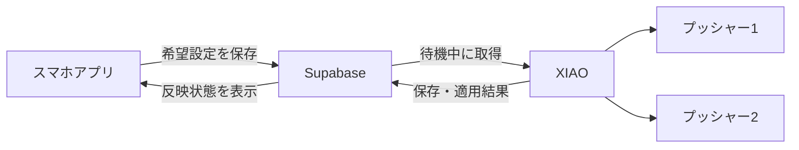

# プッシャー個数・機能割り当ての設計案

要件は[requirements.md](requirements.md)、実装と検証は[tasks.md](tasks.md)を参照。対象は最新mainのXIAO単独ファームウェア。基準コミットは`419bf5f2781383387d3a624521de627a8a6f2c50`。実装・検証状況は[検証記録](../../verification/pusher-assignment.md)に分ける。

## 採用構成

今後はXIAO＋自作基板を使う。基板の到着まではXIAOと購入済みのアンプ等で実装・検証を進め、基板到着後に同じ制御ソフトを配線に合わせて確認する。E84＋M5は初期試作であり、今後の実装対象から外す。この方針はユーザーの明示指示による。

アプリで使用個数と役割を保存し、XIAOがSupabaseから取得する。XIAOが保存・適用を終えてから結果を報告する。



## 実装着手前の根拠

以下は実装着手前のmain相当worktreeで確認した。リンクは基準コミットのソースを指す。

| 確認したこと | ソース |
|---|---|
| アプリはRepository経由で本体設定をSupabaseへ保存する。プッシャー項目はない | [deviceRepository.ts](https://github.com/jphacks/tka_2601/blob/419bf5f2781383387d3a624521de627a8a6f2c50/mobile/src/infrastructure/supabase/deviceRepository.ts)の`get`・`update`、`mobile/src/domain/device.ts` |
| 設定APIは存在するが、プッシャー設定と適用ACKはない | [contract.ts](https://github.com/jphacks/tka_2601/blob/419bf5f2781383387d3a624521de627a8a6f2c50/supabase/functions/device/contract.ts)の`settingsBody`、[handler.ts](https://github.com/jphacks/tka_2601/blob/419bf5f2781383387d3a624521de627a8a6f2c50/supabase/functions/device/handler.ts)の`handleDeviceRequest` |
| XIAOは診断要求時に音声APIの状態を確認する。設定の定期同期はない | [net_task.cpp](https://github.com/jphacks/tka_2601/blob/419bf5f2781383387d3a624521de627a8a6f2c50/firmware/xiao/net_task.cpp)の`net_task`、`firmware/xiao/door_server.c`の`door_server_check` |
| XIAOは開始ボタンの押下・復帰後に会話サーバーへ接続する | [voice_stream.c](https://github.com/jphacks/tka_2601/blob/419bf5f2781383387d3a624521de627a8a6f2c50/firmware/xiao/voice_stream.c)の`run_call` |
| 役割ごとに固定GPIOと別々の調整値を使う。NVSはXIAO独自のv1 | [servo_control.cpp](https://github.com/jphacks/tka_2601/blob/419bf5f2781383387d3a624521de627a8a6f2c50/firmware/xiao/servo_control.cpp)の`Target`・`pinFor`・`captureMotion`・`Calibration`・`loadCalibration` |
| 物理1はD8/GPIO7、物理2はD9/GPIO8、物理3はD10/GPIO9 | [board_pins.h](https://github.com/jphacks/tka_2601/blob/419bf5f2781383387d3a624521de627a8a6f2c50/firmware/xiao/board_pins.h) |

実装着手前は役割と物理出力が一体になっていた。共有ボタンへの対応には、役割の割り当てと物理プッシャーの調整値を分ける必要がある。単に同じGPIOを指定するだけでは、開始と終話の調整値はそろわない。

## アプリの設定画面

`mobile/src/app/(tabs)/settings.tsx`から「プッシャー設定」を開く。対象本体名、使用個数、割り当て、反映状態を表示し、「保存」で一括送信する。画面で編集しただけでは本体へ送らない。

| 使用個数 | 設定する内容 | 表示例 |
|---|---|---|
| 1個 | 使用するプッシャー1または2 | 通話開始も終話もプッシャー1 |
| 2個 | 通話開始の担当。終話は残りに割り当てる | 開始はプッシャー2、終話はプッシャー1 |

個数は通話開始・終話に使用する数とする。「プッシャー1・2」は接続口の識別子であり、役割名ではない。補助表示のGPIOは本体の能力報告から取得する。1個構成では、実際に2個接続されていても未選択の出力を使わない。

3番の解錠用出力は今回の割り当てに含めない。既存の調整値とUSB操作を保持し、この変更で自動解錠を有効にしない。

保存成功後は「本体への反映待ち」、通話中なら「通話終了後に反映」、本体から完了報告が届けば「本体に反映済み」と表示する。未対応が確認できた場合は「本体の更新が必要」、能力報告がない場合は「本体を確認できません」とする。反映済み表示には最後に確認した時刻を添える。

本体未登録・読込失敗時は編集を始めない。保存失敗時は編集中の値を残す。他のメンバーが先に変更した場合は、最新設定の読込を案内する。個数、割り当て、反映状態には読み上げ用のラベルを付ける。

## データと責務

クラウドに本体IDを主キーとする`device_pusher_settings`を追加する案とする。希望設定、サーバー採番の`desired_revision`、本体が報告した`applied_revision`・適用内容・確認時刻・適用エラー、対応能力を保存する。動作上の要確認状態は設定適用のエラーと分ける。使用個数は物理IDの集合から求め、別の数値として重複保存しない。

希望設定の例は次のとおり。`p1`・`p2`は物理ID、`call_start`・`call_end`は論理機能とする。

```json
{
  "schema_version": 1,
  "enabled_pushers": ["p1"],
  "assignments": {"call_start": "p1", "call_end": "p1"}
}
```

1個では両機能が有効な同じIDを参照する。2個では`p1`・`p2`を1機能ずつ使う。未知のID、未使用IDや3番への割り当て、必須機能の欠落をサーバーとXIAOで拒否する。任意のGPIOや角度はアプリから指定させない。

アプリには`PusherSettingsRepository`を追加し、型を`domain`、契約を`repositories`、Supabase通信を`infrastructure/supabase`に置く。画面から直接DBを操作しない。保存RPCは`device_id`・`expected_revision`・希望設定を受け、所属グループの確認、版の一致確認、設定更新を同じトランザクションで行う。

同じグループのメンバーが設定を編集できる既存方針を引き継ぐ。新テーブルにもRLSを設定し、アプリには所属本体の読取と保存RPCだけを許可する。適用結果・能力・版番号の直接更新は許可しない。結果報告の本体IDは本文から採用せず、既存デバイス鍵の認証結果から決める。[SupabaseのRLS仕様](https://supabase.com/docs/guides/database/postgres/row-level-security)に沿って権限を検証する。

XIAOの`servo_control`が、物理IDからGPIOへの対応、物理IDごとの待機角度・押下角度・保持時間、共通復帰時間、開始前待機、有効な割り当てと版番号を管理する。未使用側と解錠用の調整値も保持する。

`CallAction`と`PusherId`を分け、開始・終話・取消後処理は`resolvePusher(action, callSnapshot)`で実行先を決める。開始前待機、開始済み・終話済みの判定は論理機能に基づける。物理2へ開始を割り当てても、開始前待機を省略したり終話済みと判定したりしない。

通話開始時の`servo_call_open`で割り当てと動作値を固定する。全経路が共通の`motionFor(pusher)`でGPIOと調整値を取得する。USB単体テスト・位置調整は物理IDを対象とし、従来の`c/e/u`は物理1/2/3への互換名として扱う。通話の機能割り当てと混同しないラベルへ変更する。共有モードでは通話用の調整欄を1個にし、未使用側へのプレビューは拒否する。

## 同期・保存・適用

1. XIAOが起動後・再接続後・待機中に`GET /functions/v1/device/pusher-settings`を取得し、希望する版と割り当てだけを受け取る。店舗メニュー等で応答が受信上限を超えないよう、既存の総合設定APIとは別の小さい応答にする。既存`GET /settings`への項目追加も互換性を維持する。外側の既存`contract_version`と、プッシャー設定の`schema_version`を分け、既存クライアントの読取互換性を保つ。
2. 新しい同期処理は`net_task`側でクラウド通信を行い、設定一式を`servo_control`へ渡す。HTTPS通信中はサーボのロックを保持しない。通話・押下・復帰・テスト・調整・復旧中は`busy`として保留する。
3. `servo_control`が既存の排他制御下で全項目を検証し、待機時に永続保存する。保存後の読戻しに成功した設定だけを一括で有効化する。失敗や電源断で直前の正常設定を失わない保存方式を使う。
4. XIAOは有効な版と内容が読戻しに一致した後、新設の`PUT /functions/v1/device/pusher-status`で報告する。HTTP受信だけでは適用完了にしない。起動後は実際の保存値を報告し、クラウドの過去の報告だけを信用しない。

希望設定は起動直後・変更後の30秒間は5秒間隔、安定時は30秒間隔で取得する。状態報告は内容変更時または60秒のheartbeatだけとし、成功した報告だけを記録する。HTTP失敗時は間隔を延ばし、通話処理と音声取得を妨げない。チャイムと設定適用の競合は本体の所有権で処理し、適用中の通話要求は適用完了後に実行する。取得だけであれば通話要求を優先する。

クラウド管理版では、同じ版・同じ内容の再送は再書込せず完了を報告する。同じ版の別内容、古い版、未知のスキーマは拒否する。設定を戻すときも新しい版として保存する。ACKや結果報告の喪失後は現在値を照合して再報告し、クラウドの適用版を後退させない。適用報告が409となったときだけ、適用版・設定をnullにした状態報告を1回送り、要確認状態まで失われないようにする。状態報告の成功だけでは設定反映済みとしない。

未反映の希望設定を取得済みなら、適用確認まで次の自動通話を開始しない。通信断で新設定を取得できない場合は、最後の正常設定を使う。アプリは即時切替を保証せず、反映完了を確認して設置を変更する案内を表示する。

既存の`door_server`は音声API用の`DOOR_API_KEY`を使う。新しいSupabaseクライアントは登録済みの`DOOR_DEVICE_KEY`と公開APIキー、接続先・CAを使い、音声API鍵と混同しない。既存TLS基盤を再利用する。会話サーバーの設定読取は開始押下より後になるため、今回の設定同期には使わない。

## 共有ボタンの取消・障害処理

| 状態 | 取消・切断・失敗時の動作 |
|---|---|
| 開始前待機中でPWM未開始 | 押下せず終了する |
| 開始の押下・復帰が正常完了 | 同じプッシャーで終話を1回行う |
| 開始の押下・復帰が途中で中断、またはPWM失敗 | 可能な範囲で戻して停止し、追加押下をせず`manual_check_required`とする |
| 終話の押下中・完了後 | 同じ要求や取消・切断で再押下しない。失敗時は要確認とする |
| USB単体テスト | 指定の1回だけ押して戻し、終話の追加押下を行わない |

共有出力のPWM開始前に「共有操作未完了」をNVSへ保存して読み戻す。保存できなければ押下を始めない。正常な終話・復帰まで記録を保持し、完了後に消去確認する。途中の電源断・再起動で記録が残った場合や消去に失敗した場合は、要確認として起動する。

要確認では自動通話と新たな押下テストを止める。操作者が親機を手動で終話し、USB調整画面の「親機が待機中であることを確認」で記録を消去して解除する案とする。共有出力の単体テスト・位置プレビュー後もこの確認を経て自動通話へ戻る。解除自体では動かさず、設定変更や再起動では解除しない。

`servo_call_status`で要確認を通常の`ENDED`と区別し、`voice_stream`の既存復旧待ちへ接続する。クラウドへの報告とアプリ表示も追加する。現在の取消は開始途中でも戻した後にENDを押すため、共有ボタン用の分岐が必要になる。再起動後に以前の通話を再開・終話しない。

## ローカル配線設定

未プロビジョニングかつクラウド管理版がまだない場合だけ、USBの`@pusher 0 mask start end`で配線を設定できる。版は0のまま保持し、将来のクラウド版1が上書きできるようにする。`device_config.h`がある構成と、クラウド版が1以上の本体では拒否する。任意のクラウド版をUSBから指定せず、未反映の保護も解除しない。ローカル操作も共通の検証・保存を通し、QEMU専用のバイパスは設けない。

## 移行・実装順・未検証事項

XIAOのNVS名前空間`monban-servo`の既存v1を新形式へ移す。開始側の調整値を物理1、終話側を物理2、解錠側を物理3として保持し、既存2個の割り当てを初期値とする。旧M5の保存形式とは互換にしない。

クラウドに希望設定がない間は移行済みの本体設定を維持する。アプリの初期表示だけで2個構成を書き込まない。未対応ファームウェアは既存動作を維持し、反映済みと表示しない。追加契約に対応したサーバー、XIAO、アプリの順に更新し、各段階で既存通話を確認する。

購入済み部品でまず設定反映と実際の開始・終話を検証する。自作基板到着後は、ピン対応、電源、取り付け方向、実際の押下を再確認する。対象親機の共有ボタンの挙動と、手動操作・自動終話との干渉は未検証。最新XIAOのREADMEにも実機未動作と記載されており、既存ホスト・QEMU・模擬E2Eの結果を実機の動作確認へ読み替えない。

取得済みの未反映設定による通話開始の禁止は、`monban-servo/pusher-pending`へ保存し、起動時に復元する。変更時だけ書き込み、読み戻して確認する。解除は希望設定の保存・読み戻し検証後に限り、解除の保存が失敗した場合も禁止を維持する。希望設定がない応答、校正保存、USBの待機確認では解除しない。
