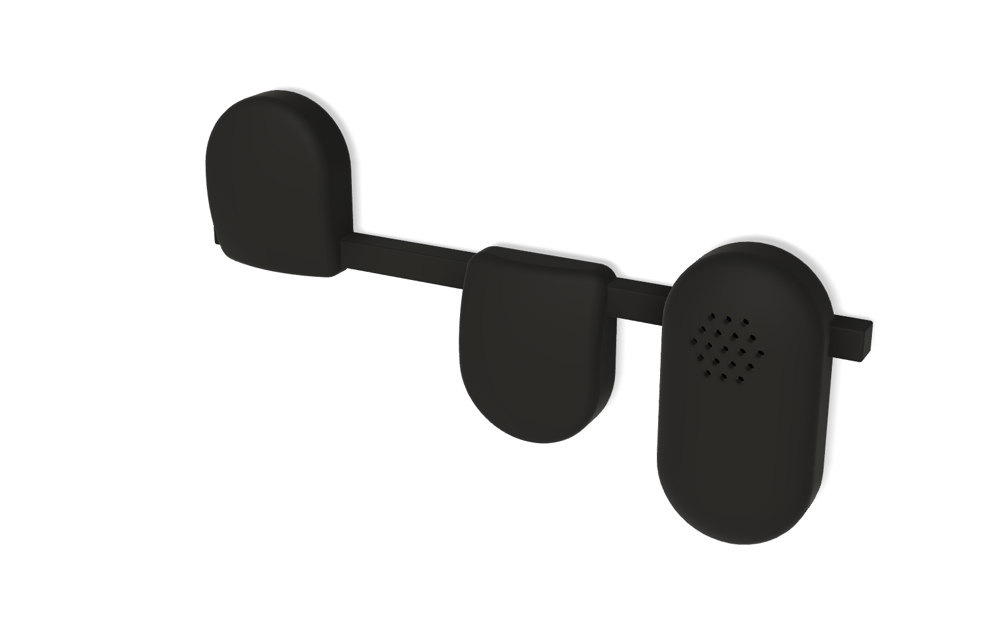
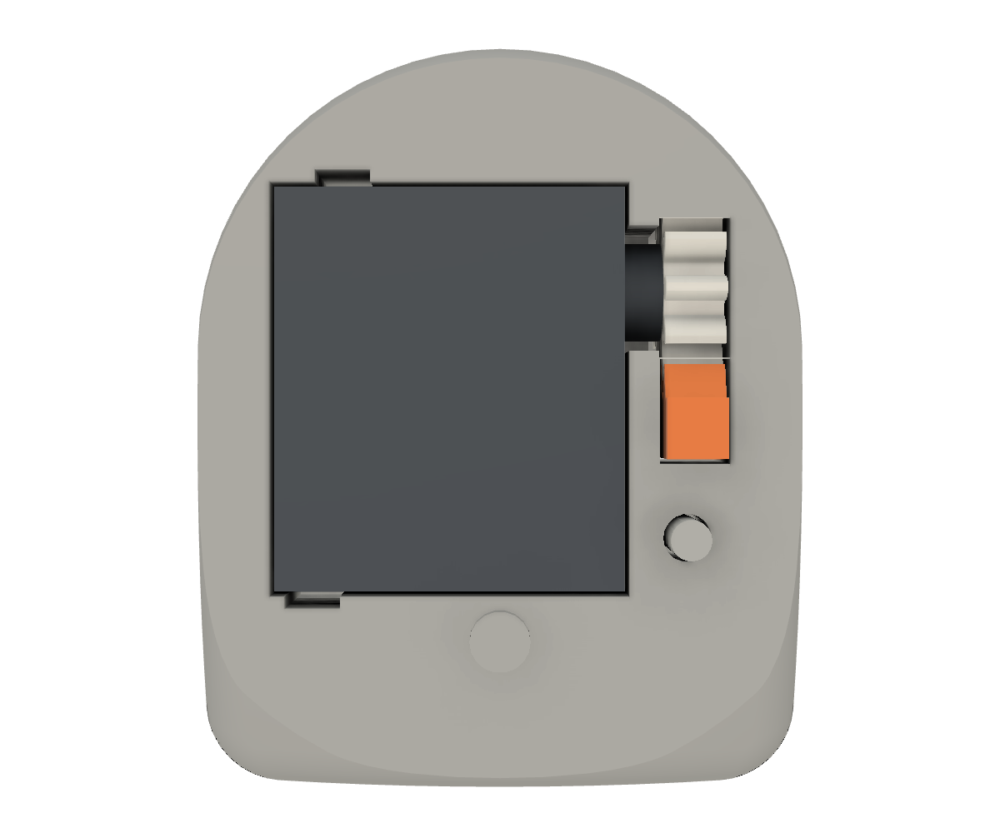
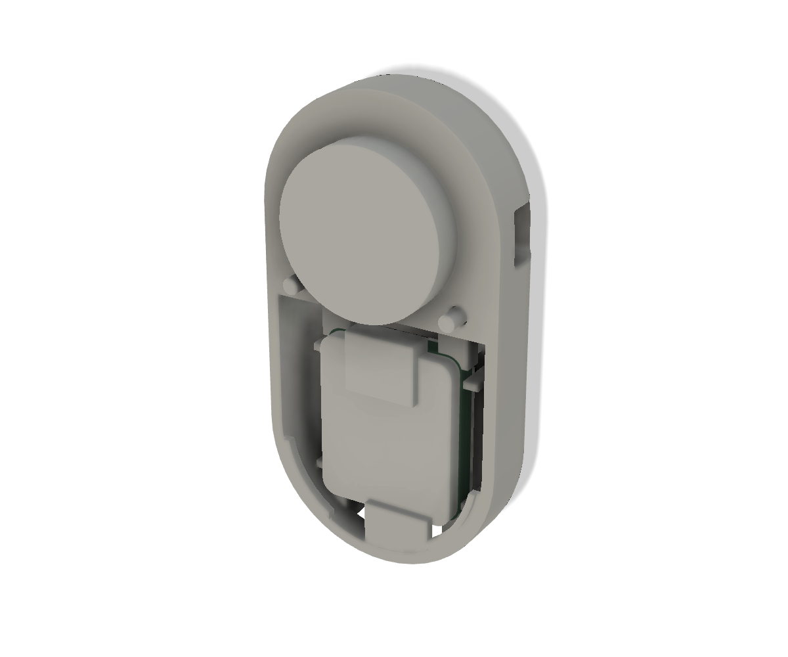
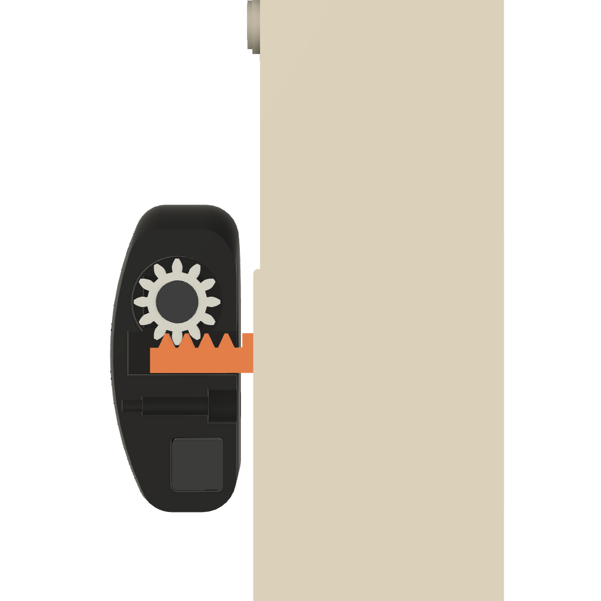
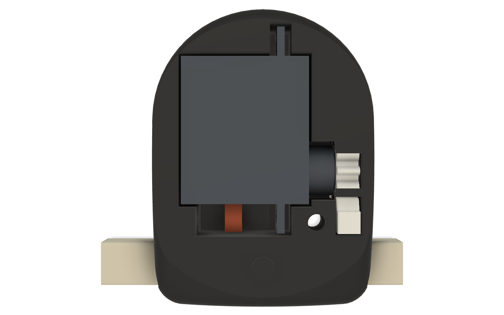
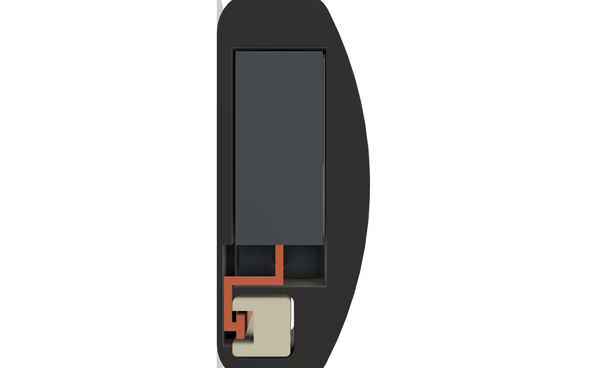
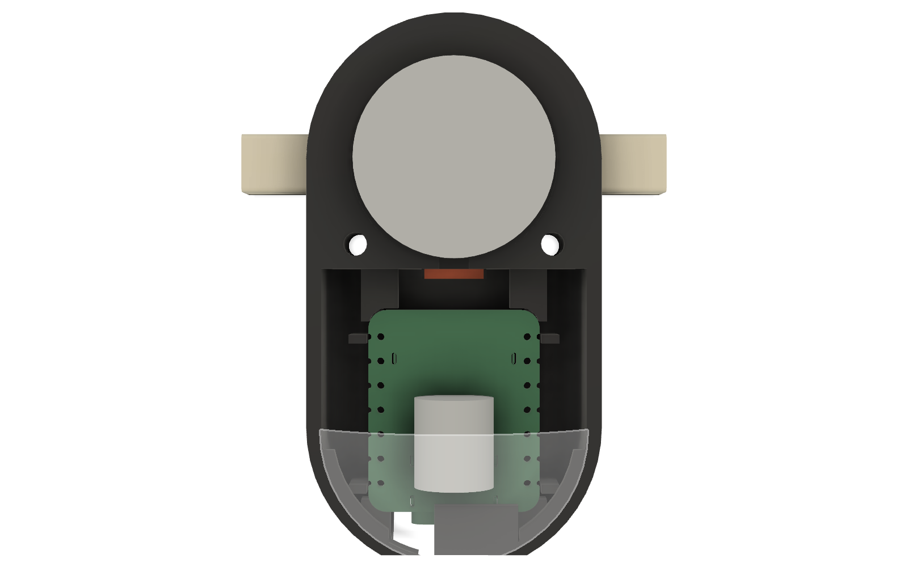

# カプセル v5（店舗向け）

小鳥と同じ串・足・押す機構を使う、顔のない外装です。プッシャーは半円と長方形を合わせた形で、背面は平ら、前面はドーム形、角はすべて丸めてあります。Fusion の設計は、プロジェクト MONBAN の `02_印刷用パーツ/MONBAN_capsule_v5` にあります。

| 部品 | 外形（幅×高さ×奥行き） | 中身 |
|---|---|---|
| プッシャー（サーボ側） | 30×37.06×15.8 mm | FS0307、ピニオン、ラック、PU パッド、M2×10 が 1 本 |
| 本体 | 30×57×19.8 mm | XIAO ESP32S3 と追加基板、φ20 スピーカー、FPC アンテナ、PU パッド、M2×10 が 2 本 |

- 幅と上の丸み（R15）は本体と同じです。左右の辺は串まで平行で、串の穴は全幅（30 mm）です。
- 180° 回すだけで、下の段のキーにも使えます。VS-MGE20 は左右逆の部品（M）を使います。
- ねじは背面から入れて、前の殻の下穴（φ1.6）に切り込みます。ナットは要りません。
- ストロークは 4 mm、串の角は R0.5、串の前の隙間は 0.2 mm です。

## 印刷

家の A1 mini（0.4 mm、PLA Basic）向けにスライス済みです。時間と重さは Bambu Studio の見積もりで、サポートは要りません。

| データ（`print/`） | 内容 | 積層 | 時間 | 重さ |
|---|---|---|---|---|
| `1_VS-MGE20_body_x2_0p20.3mf` | VS-MGE20 用の胴（M）2 個 | 0.20 mm | 26 分 | 10.4 g |
| `2_VS-MGE20_cap_gear_x2_0p12.3mf` | VS-MGE20 用の前の殻（M）、ラック、ピニオン 各 2 個 | 0.12 mm | 17 分 | 4.4 g |
| `1_other_models_body_x2_0p20.3mf` | ほかの機種用の胴（N）2 個 | 0.20 mm | 26 分 | 10.4 g |
| `2_other_models_cap_gear_x2_0p12.3mf` | ほかの機種用の前の殻（N）、ラック、ピニオン 各 2 個 | 0.12 mm | 17 分 | 4.4 g |
| `3_main_back_0p20.3mf` | 本体の背面 | 0.20 mm | 17 分 | 6.7 g |
| `4_main_front_0p12.3mf` | 本体の前面 | 0.12 mm | 18 分 | 3.9 g |

`*_0p08HQ.3mf` は同じ部品の高品質版です（0.08 mm High Quality、外壁 60 mm/s）。2 個分で胴 1 時間 18 分、前の殻と歯車 31 分で、PLA は約 15 g です。

1 枚のプレートで終わる夜間用もあります。`overnight_all_models_set_0p08HQ.3mf` は N と M の胴と前の殻を各 2 個、ラックとピニオンを各 6 個で、3 時間 44 分、31 g です。`overnight_VS-MGE20_set_0p08HQ.3mf` は M の胴と前の殻を各 2 個、ラックとピニオンを各 4 個で、1 時間 57 分、15.9 g です。

試作の確認に使う標準のセットは、プッシャー 2 個、本体 1 個、ラックとピニオン各 2 個です。設定は 0.08 mm High Quality です。OrcaSlicer の ZAA（0.16 mm）も試しましたが、側面の段差が 0.08 mm より多かったので採用しません。

`stl/rail_mock_134.4mm_PLA.stl` は、串の試作です（VS-MGE20 の長さ、断面 6×6 mm、角 R0.5）。部品の通り方と滑り方を確かめるためのもので、PLA はアルミより大きくたわむので、押す力の確認には使えません。作り直すときは `calc/make_rail_mock.py` に長さを渡します。

## v6（配線を外に出さない形）

FS0307 の羽根を形状に入れていなかったので、v5 のプッシャーには実物が入りません。v6 で次のように直しました。Fusion の設計は `02_印刷用パーツ/MONBAN_capsule_v6` です。

- **サーボ：** 羽根を含む形を Fusion に作りました。軸と線の側を串に向けたので、押す点から串の中心までが 13.6 mm から 6.9 mm に縮みました。プッシャーの外形は 30×41×16 mm です（v5 は 30×37×15.8 mm）。
- **固定：** 穴は小さく印刷されるので、余裕を持たせてグルーガンで固定します。ピニオンをサーボの軸に付け、ラックとかみ合わせた状態で接着すれば、軸の位置の誤差を吸収できます。
- **配線：** 串の背面（インターホン側）に幅 3.4、深さ 2.2 mm の溝を切り、サーボの線を溝に沿わせて親機へ通します。前からは見えません。
- **基板が届くまでの給電：** XIAO を裏返して追加基板の位置に入れ、XIAO 自身の USB-C に電源をつなぎます。サーボの線は XIAO の 5V、GND、D8 にはんだ付けします。470 µF のコンデンサは XIAO の前に寝かせて入ります。
- **線の長さ：** FS0307 の線は 149 mm なので、延長しない場合は、押す点から親機の中心までを約 80 mm 以内にします。

製品のアルミの串（6×6×1 mm の角パイプ）は、背面にスリットを切って同じ通し方にする想定です。スリットの長さとねじれは、実物で確かめていません。

実物で確かめていないこと：XIAO の 5V ピンからサーボへ給電したときの動作、線が溝に収まるか、グルーガンの固定で押す力に耐えるか。ボスと軸の高さ、線の太さは写真からの見積もりです。

`print/plate_v6_set_rail200_PLA.3mf` は親機 1 個、プッシャー 2 個、ラックとピニオン各 2 個、溝付きの串の試作（5.88 mm 角、200 mm）で、0.08 mm High Quality、3 時間 40 分（準備を含む）、30.75 g です（Bambu Studio の見積もり）。`calc/make_plate_v6.py` がプレートを作ります。

## ねじなしの足

M3 のねじとナットをやめて、印刷したくさびで足を串に止める形にしました。`calc/make_paw_wedge.py` が `stl/paw_L_std_wedge_PLA.stl`、`paw_R_std_wedge_PLA.stl`、`paw_wedge_PLA.stl` を作ります。古い足の STL から作るので、Fusion の設計にはまだ入っていません。

- 足を寄せてスポンジをつぶし、くさびの細い方から押し込みます。くさびが串を前から押さえて、摩擦で止まります。止まる位置は串のどこでも構いません。
- 外すときは、反対側の開口から細い棒でくさびを押し出します。
- 足の内側に粘着スポンジを貼ります。くさびで止める位置を変えられるので、厚さが 3 mm でなくても試せます。
- 串は加工しないので、製品のアルミの串にも使えるはずです。
- 印刷のために、足の玉の内側を頬の内面で平らに切りました。サポートは要りません。
- 止まる力とくさびの押し込みやすさは、実物で確かめていません。

`print/plate_paws_rail200_wedges_PLA.3mf` は、家のインターホン（幅 180 mm、奥行き 40 mm 弱）用です。足 2 個、くさび 4 個（2 個は予備）、串の試作（5.88 mm 角、200 mm）で、0.08 mm High Quality、1 時間 10 分、9.67 g です（Bambu Studio の見積もり）。串の長さは、右の壁に当たらないよう、足の中で終わる長さにしました。

`print/zaa_trial/` は、ZAA を試したときのデータです。

`stl/` の STL は、そのまま置くと印刷する向きになります。M は `capsule_pusher_*_M_PLA.stl` で、ラックとピニオンは N と共通です。足の 4 ファイルは小鳥の STL を写したものです。1 段の機種は `std`、2 段の機種は `two-rows` を使います。

## 収まりの確認

`fusion/capsule.py` が、実物の寸法で作った部品と印刷部品の重なりを Fusion で計算します。ラックは静止、半分、最大（5 mm）の 3 位置、ピニオンは回転で通る範囲を確認しました。

| 確認した組み合わせ | 件数 | 想定外の干渉 |
|---|---|---|
| プッシャー | 23 | 0 |
| 本体 | 153 | 0 |

重なりが出た組み合わせは、M2 ねじが下穴に切り込む所と、余裕を見て大きく取った参考形状どうしだけです。

| 距離 | mm |
|---|---|
| FS0307 と胴の穴 | 0.25 |
| ラックの逃げと前の殻の表面（最も薄い所） | 0.7 前後 |
| サーボの穴の角の肉厚（最も薄い所） | 0.6〜0.8 |

本体の寸法は v2 と同じです。スピーカーは厚さ 4 mm で確認しました。商品説明の 3.6 mm なら、0.4 mm の隙間にスポンジを挟みます。

## 実物で確かめること

次の項目は計算だけでは分かりません。

1. FS0307 の線の出口と、ホーンのハブ（φ5）にピニオンが合うか。
2. サーボでラックが動き、キーを押せるか。押す力は未測定です。
3. 串の滑り方（3〜5 N の想定）。
4. 前の殻がねじで閉じるか。プッシャーのねじの掛かりは約 2.15 mm と短く、締めすぎると下穴がつぶれます。
5. XIAO の下端を背面側のかぎに差し、前の殻の腕で USB-C を押さえて固定できるか。
6. スピーカーの音量と、Wi-Fi の受信。アンテナは曲げて貼るので、電波の性能は未確認です。
7. 肉厚 0.6〜0.8 mm の角が、印刷で欠けないか。
8. FPC アンテナの折り目が、内側の丸みに沿って収まるか。

## 機種への取り付けで注意すること

VS-MGE20 の下の段では、押す点から下端まで 18.2 mm です。推定の台の縁に約 6.9 mm 当たります。終了キーの中心から台の縁の上端まで 20.4 mm 以上あれば当たりません。台の縁の位置は推定値です。機種ごとの結果は [calc/README.md](calc/README.md) にあります。

## 作り直す

Fusion で `fusion/capsule.py` を読み込み、`check_pusher()`、`check_main()`、`build_doc()`、`export_stl()` の順に実行します。実行の前に、自分の設計ドキュメントを開いて `DOC['des']` に入れてください。`export_stl()` の STL は設計の座標のままです。ラックとピニオンは倒してから使います。
